# Hướng dẫn sử dụng KTX Care

Dành cho sinh viên và cán bộ quản lý ký túc xá. Ảnh chụp từ dữ liệu demo ngày 05/11/2026.

* **Địa chỉ:** `https://ktx-care.vercel.app`
* **Trình duyệt:** Chrome, Edge bản mới, dùng được trên điện thoại.
* **Tài khoản demo:** `demo_admin`, `demo_manager`, `demo_student`. Mật khẩu do nhóm cung cấp.
* **Lần đầu mở:** máy chủ miễn phí có thể mất khoảng một phút để khởi động.

## 1. Dùng chung

### Đăng nhập

* Mở trang chủ, bấm "Bắt đầu sử dụng" hoặc "Đăng nhập".
* Nhập tên đăng nhập, mật khẩu, bấm "Đăng nhập".
* Sinh viên vào Hồ sơ cá nhân, cán bộ vào Tổng quan.
* Sai mật khẩu 5 lần thì tạm khóa 15 phút.

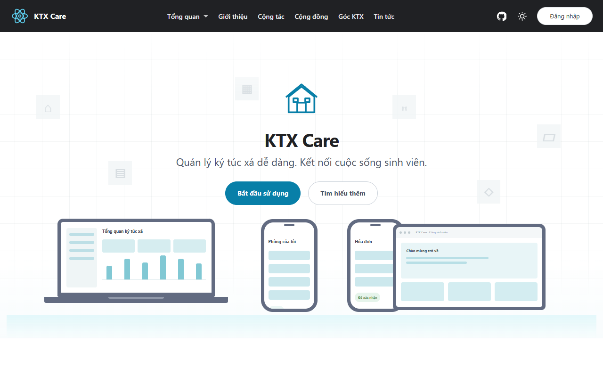

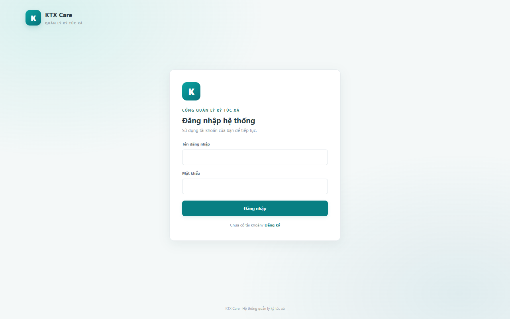

### Đổi mật khẩu, đăng xuất

* Bấm "Đổi mật khẩu" ở góc trên bên phải.
* Nhập mật khẩu hiện tại, mật khẩu mới (ít nhất 6 ký tự), nhập lại, rồi bấm "Đổi mật khẩu".
* Dùng máy chung thì bấm "Đăng xuất" khi xong. Phiên đăng nhập tự hết hạn sau 1 giờ.

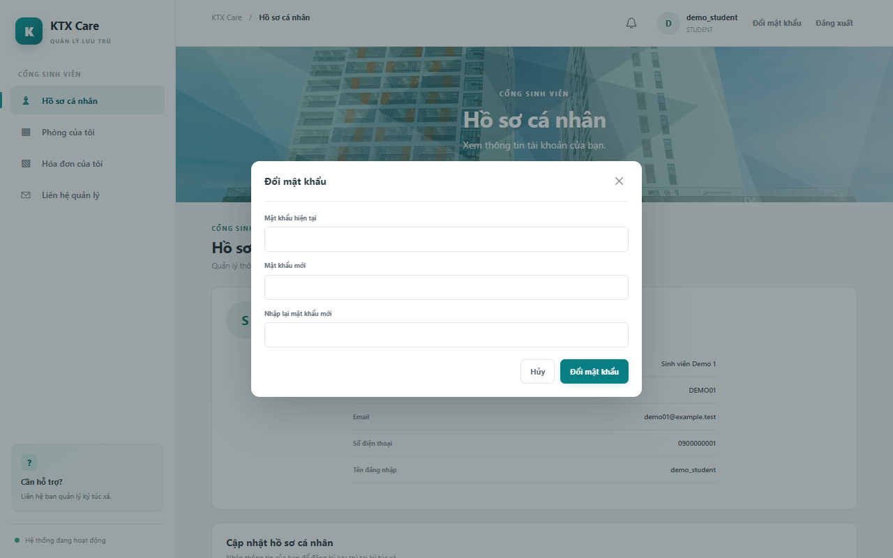

### Thông báo

* Biểu tượng chuông có chấm đỏ là có thông báo chưa đọc. Bấm vào để xem, bấm "Đánh dấu đã đọc".

## 2. Sinh viên

### Đăng ký tài khoản

* Ở trang đăng nhập bấm "Đăng ký". Nhập tên đăng nhập, mật khẩu, xác nhận mật khẩu.
* Tài khoản tự đăng ký luôn là tài khoản sinh viên.

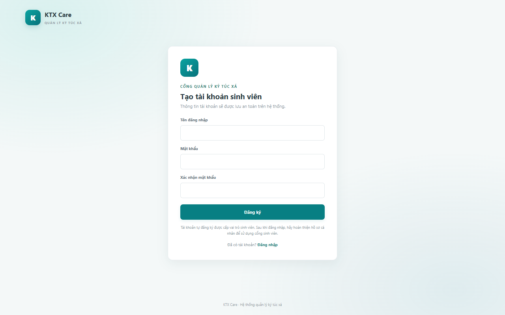

### Hoàn thiện hồ sơ

* Vào Hồ sơ cá nhân, điền mã sinh viên, họ tên, email, số điện thoại, bấm "Lưu hồ sơ cá nhân".
* Mã sinh viên không sửa được sau khi lưu.

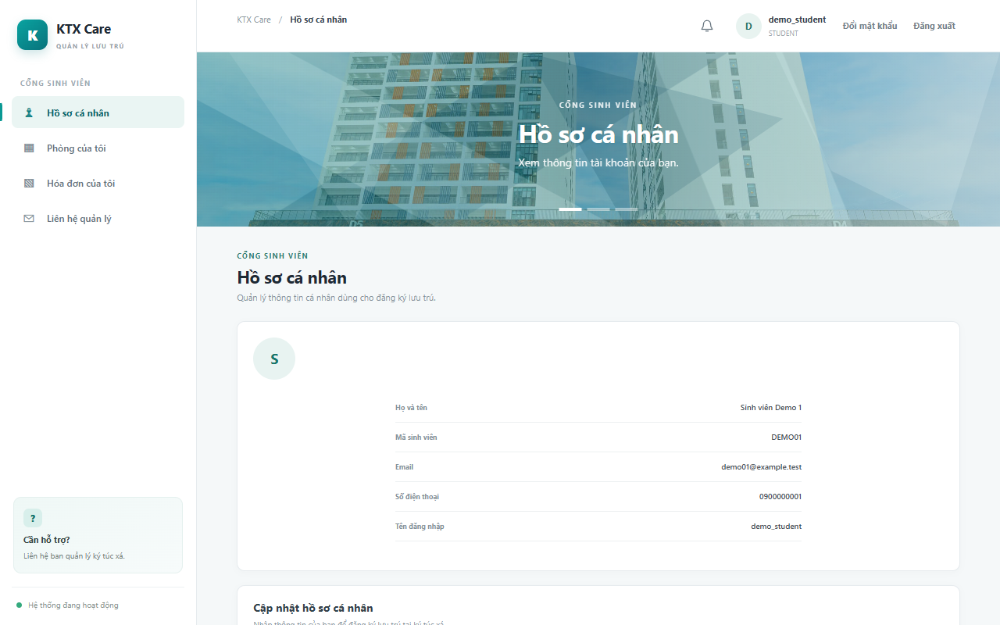

### Đăng ký ở, xem phòng

* Vào Phòng của tôi, nhập ghi chú nếu cần, bấm nút gửi yêu cầu lưu trú. Cán bộ duyệt và xếp phòng, kết quả báo qua chuông thông báo.
* Khi đã có phòng, trang này hiện số phòng, tòa, các bạn cùng phòng.

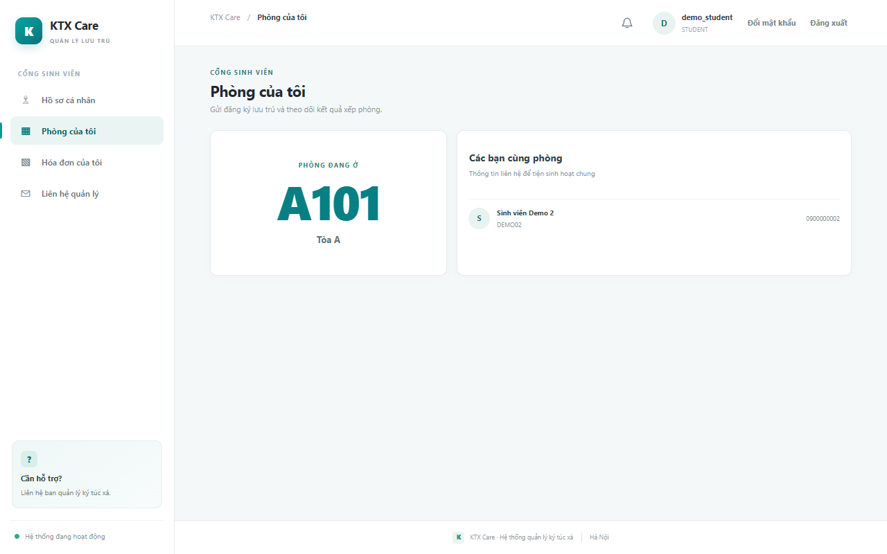

### Xem hóa đơn, gửi chỉ số điện nước

* Vào Hóa đơn của tôi để xem tiền phòng, điện nước, hạn đóng và trạng thái.
* Mỗi kỳ, một sinh viên trong phòng nhập chỉ số điện, nước, chọn ảnh công tơ, bấm "Gửi chỉ số cho quản lý xác nhận".
* Đóng tiền trực tiếp cho ban quản lý. Cán bộ ghi nhận xong, hóa đơn chuyển thành đã thanh toán.

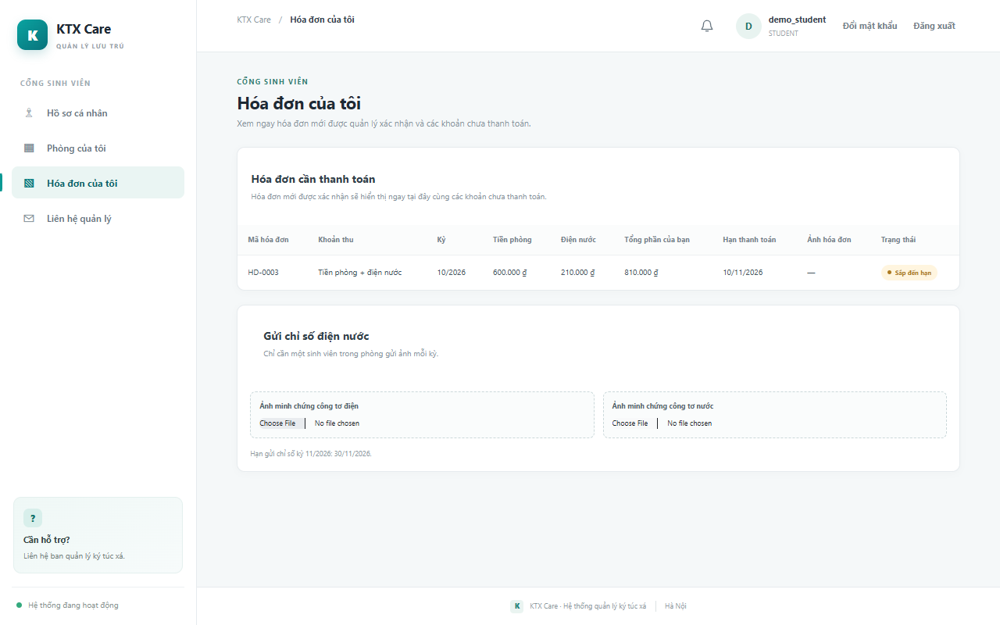

### Liên hệ

* Vào Liên hệ quản lý để lấy email, số điện thoại của ban quản lý.

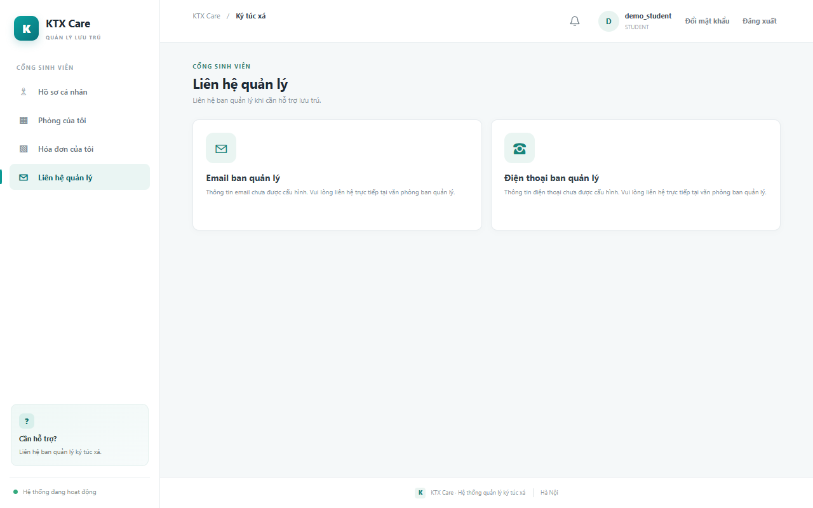

## 3. Cán bộ quản lý

Tài khoản ADMIN và MANAGER dùng chung các chức năng dưới đây, trừ mục Cài đặt.

### Tổng quan

* Xem số phòng, sinh viên, hợp đồng, hóa đơn chưa thu, tỷ lệ lấp đầy theo tòa và việc cần làm.

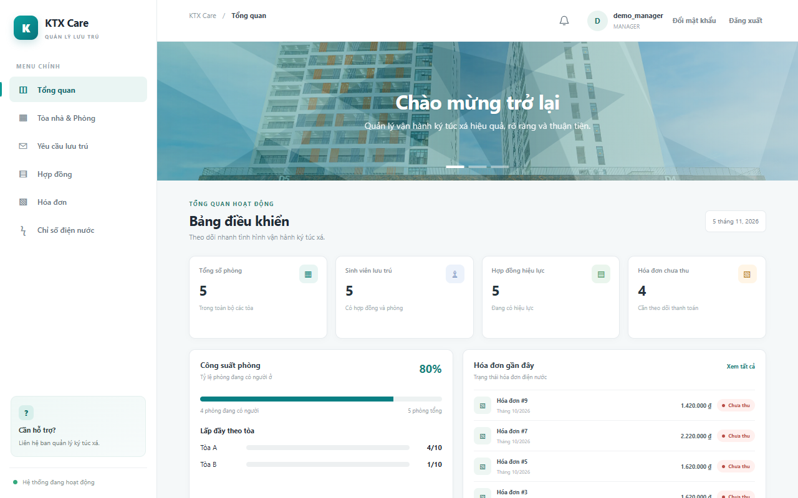

### Tòa nhà và phòng

* Vào Tòa nhà & Phòng, bấm một tòa để xem sơ đồ phòng theo tầng. Màu thẻ cho biết phòng còn chỗ, đang ở, đã đầy, bảo trì.
* Bấm "Thêm phòng" để tạo phòng. Bấm vào thẻ phòng để xem, sửa, xóa.

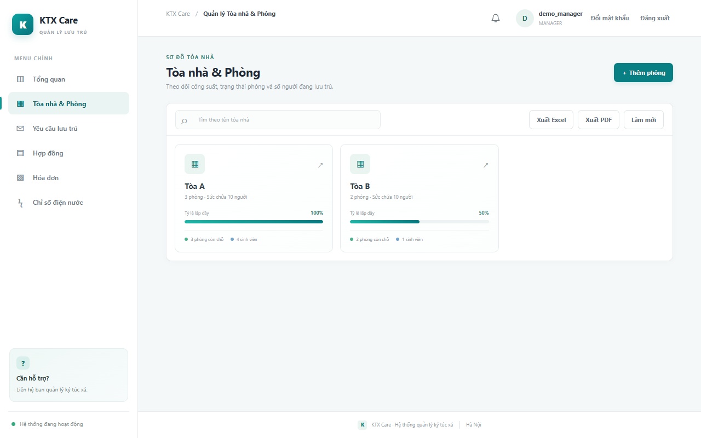

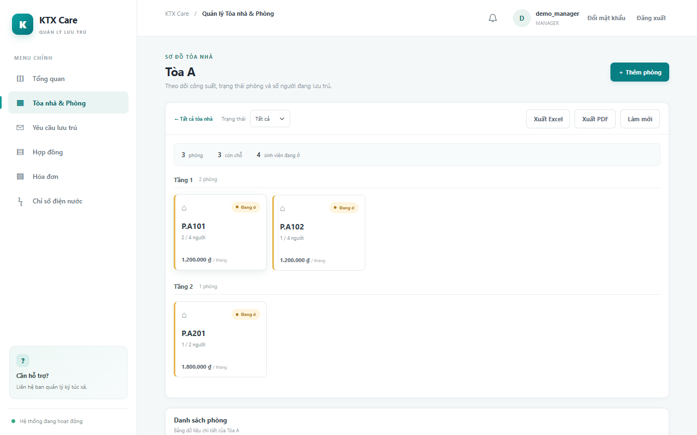

### Duyệt yêu cầu lưu trú

* Vào Yêu cầu lưu trú. Bấm "Duyệt / xếp phòng", chọn tòa, tầng, phòng còn chỗ rồi xác nhận.
* Bấm "Từ chối" nếu không duyệt. Sinh viên nhận được thông báo.

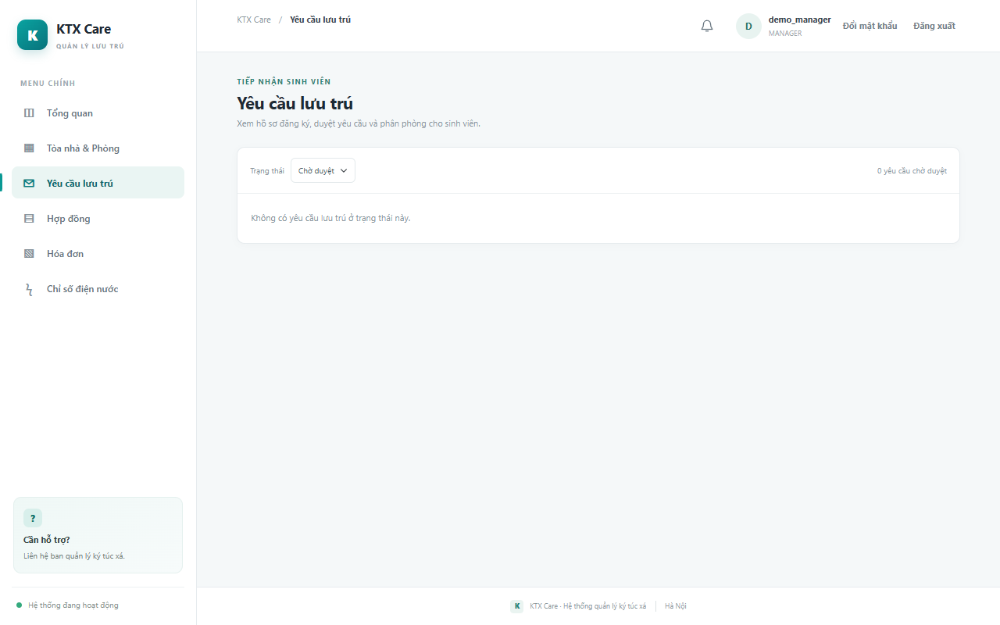

### Hợp đồng

* Vào Hợp đồng để xem, lọc theo trạng thái. Bấm "Tạo hợp đồng", "Sửa / Gia hạn", "Thanh lý" theo nhu cầu.

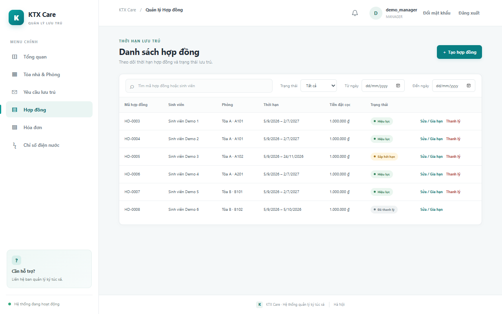

### Duyệt chỉ số điện nước

* Vào Chỉ số điện nước. Ở bảng chờ xác nhận, bấm "Xem ảnh / xác nhận".
* Đối chiếu ảnh công tơ với chỉ số, sửa nếu sai, bấm "Xác nhận và tạo hóa đơn".
* Ảnh không rõ thì bấm "Yêu cầu gửi lại" và ghi chú cho sinh viên.

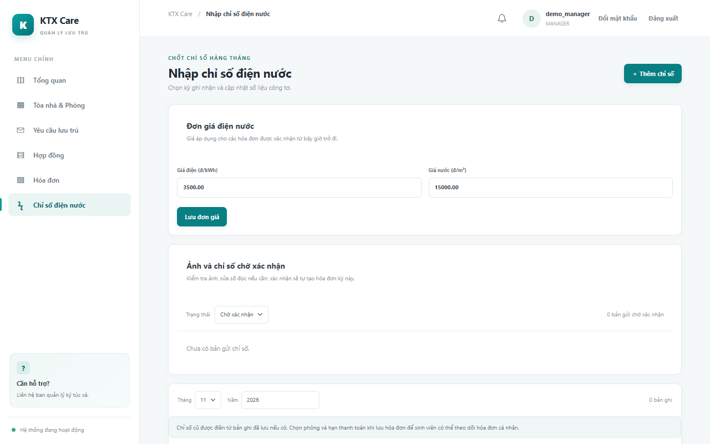

### Hóa đơn và thu tiền

* Vào Hóa đơn, lọc theo trạng thái, kỳ, tòa. Bấm "Xem" để mở chi tiết.
* Trong chi tiết, bấm "Đánh dấu đã thu" cho từng sinh viên. Bấm "Gửi nhắc" với khoản quá hạn.
* Bấm "Tạo hóa đơn" để thêm khoản thu khác cho một phòng. Bấm "In hóa đơn" để in hóa đơn đang xem.

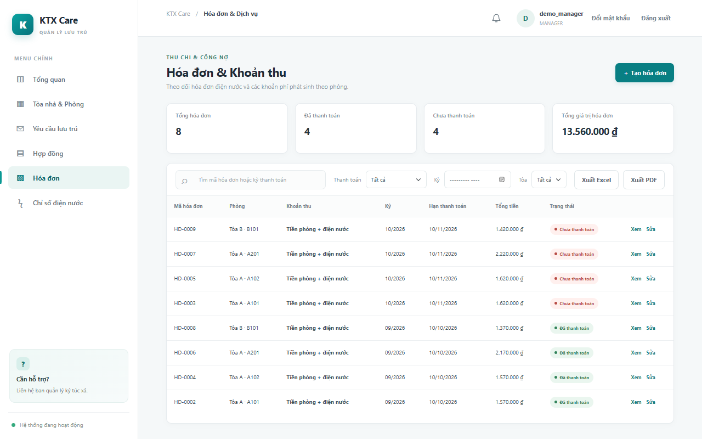

### Xuất Excel, PDF

* Có ở trang Tòa nhà & Phòng và trang Hóa đơn. File gồm các dòng đang lọc trên màn hình.
* "Xuất Excel" tải về file `.xlsx`.
* "Xuất PDF" mở hộp in. Ở mục máy in chọn "Lưu dưới dạng PDF" (Save as PDF), rồi bấm Lưu.
* File có thông tin của sinh viên, chỉ dùng cho công việc, không gửi cho người ngoài.

## 4. Quản trị viên (ADMIN)

* Vào Cài đặt để sửa đơn giá điện, nước. Đơn giá mới áp dụng cho hóa đơn tạo từ lúc đó.
* Ở Tài khoản cán bộ, nhập tên đăng nhập, mật khẩu, bấm "Tạo cán bộ". Đổi vai trò ở cột Vai trò.
* Không tự đổi được vai trò của chính mình. Hệ thống luôn giữ ít nhất một ADMIN.

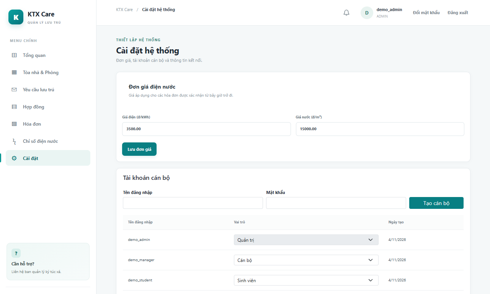

## 5. Khi gặp lỗi

* Báo "Phiên đăng nhập đã hết hạn": đăng nhập lại.
* Báo "Bạn không có quyền": tài khoản không có quyền với chức năng này, liên hệ ADMIN.
* Báo "nhập sai quá nhiều lần": chờ đủ thời gian ghi trong thông báo rồi thử lại.
* Trang tải mãi không xong: máy chủ đang khởi động, chờ khoảng một phút rồi tải lại.
