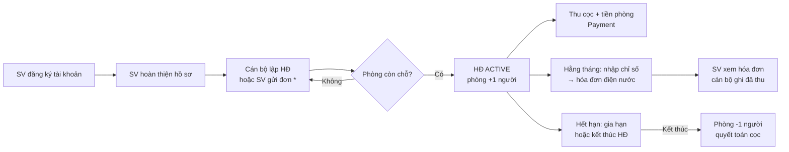
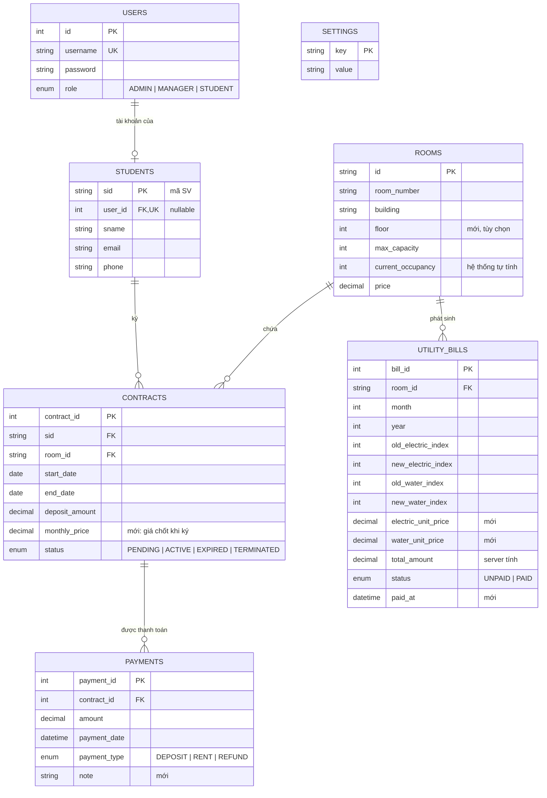

# Kế hoạch thiết kế đích — KTX Care

> **Trạng thái: BẢN ĐỀ XUẤT, CHỜ NHÓM DUYỆT.**
> Tài liệu này mô tả hệ thống **khi hoàn thiện** sẽ hoạt động thế nào. Hiện trạng code xem [readme.md](../readme.md), tiến độ và việc cần làm xem [checklist.md](../checklist.md), yêu cầu của đề thi xem [de-bai.md](de-bai.md).
> Phần backend (mô hình dữ liệu, API) là **đề xuất từ phía frontend**, người phụ trách backend quyết định cách làm. Các chỗ còn phải chốt được đánh dấu **[Chốt 2.x]**, tương ứng mục 2 trong checklist.
> Khi nhóm đã chốt, cập nhật tài liệu này theo quyết định; khi viết readme bản cuối (checklist 10.1) có thể gộp nội dung vào readme rồi bỏ file này.

---

## 1. Mục tiêu sản phẩm

Một hệ thống web giúp:
- **Ban quản lý KTX** quản lý phòng, sinh viên, hợp đồng, chỉ số điện nước, hóa đơn và thanh toán ở một chỗ, thay cho sổ sách/Excel.
- **Sinh viên** tự xem phòng, hợp đồng, hóa đơn của mình và gửi yêu cầu, không phải lên văn phòng hỏi.

Thước đo "hoàn thành": chạy trọn được luồng chính ở mục 3 trên bản đã triển khai, với dữ liệu mẫu, cho cả 3 vai trò.

## 2. Vai trò và quyền

| Chức năng | ADMIN | MANAGER | STUDENT |
|---|:-:|:-:|:-:|
| Xem tổng quan, báo cáo | ✔ | ✔ | — |
| Quản lý tòa nhà, phòng | ✔ | ✔ | — |
| Quản lý hồ sơ sinh viên | ✔ | ✔ | Chỉ hồ sơ của mình (sửa SĐT, email) |
| Lập / duyệt / gia hạn / kết thúc hợp đồng | ✔ | ✔ | Xem HĐ của mình, gửi yêu cầu gia hạn/trả phòng |
| Nhập chỉ số điện nước, lập hóa đơn | ✔ | ✔ | — |
| Ghi nhận thanh toán | ✔ | ✔ | Xem lịch sử thanh toán của mình |
| Cấu hình đơn giá | ✔ | — | — |
| Quản lý tài khoản cán bộ (tạo MANAGER, đổi vai trò) | ✔ | — | — |
| Đăng ký ở, gửi yêu cầu sửa chữa *(mở rộng)* | — | Duyệt / xử lý | ✔ |

- Đăng ký công khai luôn tạo tài khoản `STUDENT` (đã có). Tài khoản `ADMIN` đầu tiên tạo bằng script seed; `MANAGER` do `ADMIN` tạo trong trang Cài đặt.
- Quyền phải được kiểm tra **ở backend** (guard), giao diện chỉ ẩn/hiện cho tiện.

## 3. Luồng nghiệp vụ chính

\* Đơn đăng ký ở trực tuyến là phần mở rộng **[Chốt 2.6]**. Nếu không làm, cán bộ lập HĐ trực tiếp.

**L1. Tài khoản và hồ sơ.** SV đăng ký tài khoản → điền hồ sơ (mã SV, họ tên, email, SĐT). Hồ sơ gắn 1–1 với tài khoản. Cán bộ cũng có thể tạo hồ sơ trước, rồi SV đăng ký và được liên kết theo mã SV **[Chốt 2.2]**.

**L2. Lập hợp đồng và xếp phòng.** Cán bộ chọn SV + phòng còn chỗ + thời hạn + tiền cọc → HĐ `ACTIVE`, sĩ số phòng tăng 1. Giá thuê được chốt vào HĐ tại thời điểm ký (đổi giá phòng sau này không ảnh hưởng HĐ cũ).

**L3. Thu tiền cọc, tiền phòng.** Mỗi lần thu tạo một `Payment` gắn với HĐ. Màn hình HĐ hiện tổng phải thu, đã thu, còn nợ.

**L4. Điện nước hằng tháng.** Cán bộ chọn tòa + tháng → bảng các phòng, chỉ số cũ tự điền từ tháng trước → nhập chỉ số mới → hệ thống tính tiền theo đơn giá hiện hành → tạo hóa đơn cho từng phòng. SV ở phòng đó thấy hóa đơn trong cổng sinh viên. Có chia theo đầu người hay không: **[Chốt 2.4]**.

**L5. Gia hạn / kết thúc.** HĐ còn ≤ 30 ngày hiện cảnh báo. Gia hạn: cập nhật ngày kết thúc (hoặc tạo HĐ mới nối tiếp). Kết thúc: HĐ `TERMINATED`, sĩ số phòng giảm 1, ghi khoản hoàn cọc nếu có. HĐ quá ngày kết thúc mà chưa xử lý thì coi là `EXPIRED`.

**L6. Yêu cầu sửa chữa** *(mở rộng, [Chốt 2.6])*. SV gửi mô tả + phòng → cán bộ chuyển trạng thái Mới → Đang xử lý → Xong.

## 4. Quy tắc nghiệp vụ

Các quy tắc này phải được kiểm ở backend và dùng làm ca kiểm thử.

| Mã | Quy tắc |
|---|---|
| R1 | Sĩ số phòng không vượt sức chứa; không giảm sức chứa xuống dưới sĩ số hiện tại. |
| R2 | Một SV chỉ có tối đa 1 HĐ `ACTIVE` tại một thời điểm. |
| R3 | `end_date` > `start_date`; tiền cọc, giá ≥ 0. |
| R4 | Sĩ số phòng do hệ thống tự cập nhật khi HĐ chuyển trạng thái, không nhập tay. Tạo/kết thúc HĐ và cập nhật sĩ số nằm trong cùng transaction. |
| R5 | Không xóa phòng còn HĐ `ACTIVE`; không xóa SV còn HĐ hoặc còn nợ (chuyển sang ngừng hoạt động thay vì xóa cứng). |
| R6 | Mỗi phòng chỉ có 1 hóa đơn điện nước cho mỗi (tháng, năm). |
| R7 | Chỉ số mới ≥ chỉ số cũ; chỉ số cũ lấy từ hóa đơn tháng trước của phòng (tháng đầu nhập tay). |
| R8 | `total_amount` do server tính: (điện mới − cũ) × đơn giá điện + (nước mới − cũ) × đơn giá nước. Đơn giá được lưu kèm hóa đơn tại thời điểm lập. |
| R9 | Hóa đơn đã thanh toán thì không sửa chỉ số. |
| R10 | STUDENT chỉ đọc/sửa được dữ liệu của chính mình (xác định qua tài khoản trong token, không qua tham số URL). |

## 5. Mô hình dữ liệu đích (đề xuất)

**Thay đổi so với hiện tại**
- Thêm `STUDENTS.user_id` (liên kết tài khoản), bỏ cột `STUDENTS.role` (đã có ở `USERS`).
- Nối khóa ngoại `CONTRACTS.room_id`, `UTILITY_BILLS.room_id` (đang comment trong code).
- `CONTRACTS.is_active` → `status`; thêm `monthly_price`.
- `UTILITY_BILLS.is_paid` → `status` + `paid_at`; thêm đơn giá lưu kèm; ràng buộc duy nhất (`room_id`, `month`, `year`).
- `PAYMENTS`: `payment_type` thành enum, thêm `note`.
- Thêm bảng `SETTINGS` lưu đơn giá điện, nước **[Chốt 2.5]**.
- *(Mở rộng)* `REGISTRATION_REQUESTS`, `MAINTENANCE_REQUESTS` nếu làm L6 và đơn đăng ký trực tuyến **[Chốt 2.6]**.

**Còn phải chốt**
- Quy ước đặt tên và kiểu khóa chính (Room đang UUID, Student mã chuỗi, còn lại số tự tăng) **[Chốt 2.1]**. Sơ đồ trên tạm giữ kiểu khóa hiện tại.
- Tiền điện nước thu theo phòng hay chia đầu người; thanh toán điện nước ghi vào `PAYMENTS` hay chỉ đổi trạng thái hóa đơn **[Chốt 2.4]**.

## 6. API đích (đề xuất)

Ký hiệu: ✅ đã có · 🔧 có nhưng cần sửa · ➕ cần thêm. Mọi endpoint (trừ đăng ký/đăng nhập) yêu cầu JWT; cột Quyền là vai trò được phép.

| | Method & đường dẫn | Quyền | Ghi chú |
|---|---|---|---|
| ✅ | `POST /auth/register`, `POST /auth/login`, `GET /auth/profile` | Công khai / đăng nhập | |
| ➕ | `GET /users`, `POST /users`, `PATCH /users/:id/role` | ADMIN | Quản lý tài khoản cán bộ |
| ✅ | `/rooms` CRUD | ADMIN, MANAGER | Thêm lọc `?building=&status=`; chặn xóa theo R5 |
| ➕ | `GET /rooms/:id/occupants`, `GET /rooms/available` | ADMIN, MANAGER | SV đang ở; phòng còn chỗ (cho form HĐ) |
| 🔧 | `/student` CRUD | ADMIN, MANAGER | Thêm guard + DTO, tìm kiếm `?q=` |
| 🔧 | `/contract` CRUD | ADMIN, MANAGER | Thêm guard + DTO, `room_id`, lọc `?status=` |
| ➕ | `POST /contract/:id/terminate`, `POST /contract/:id/renew` | ADMIN, MANAGER | Theo R1–R4 |
| ➕ | `/payments` CRUD, `GET /contract/:id/payments` | ADMIN, MANAGER | |
| 🔧 | `/utility-bill` CRUD | ADMIN, MANAGER | Thêm guard + DTO, `room_id`, server tính tiền (R6–R9) |
| ➕ | `GET /utility-bill/draft?building=&month=&year=`, `POST /utility-bill/batch` | ADMIN, MANAGER | Bảng nhập nhanh cả tòa |
| ➕ | `GET /settings`, `PUT /settings` | Đọc: ADMIN, MANAGER · Sửa: ADMIN | Đơn giá |
| ➕ | `GET /reports/summary?month=&year=` | ADMIN, MANAGER | Số liệu cho trang Tổng quan |
| ➕ | `GET /me/student`, `PATCH /me/student` | STUDENT | Hồ sơ của tôi |
| ➕ | `GET /me/contract`, `GET /me/bills`, `GET /me/payments` | STUDENT | Theo R10 |

Danh sách lớn hỗ trợ phân trang `?page=&limit=`. Lỗi trả mã nhất quán: 400 sai dữ liệu, 401 chưa đăng nhập, 403 sai quyền, 404 không tìm thấy, 409 vi phạm ràng buộc (trùng, hết chỗ).

## 7. Giao diện đích

Giữ khung hiện có (sidebar + header, hash routing, CSS tự viết). Mỗi trang phải có đủ trạng thái đang tải / rỗng / lỗi, dùng được ở khổ 375px. Thao tác xóa hoặc kết thúc HĐ có hộp xác nhận, kết quả báo bằng toast. Thay đổi giao diện lớn sẽ làm bản mẫu tĩnh để duyệt trước.

### 7.1. Khu quản lý (ADMIN, MANAGER)

| Trang | Nội dung đích |
|---|---|
| Tổng quan `#overview` | Thẻ số liệu: tổng phòng, % lấp đầy, SV đang ở, HĐ sắp hết hạn, hóa đơn chưa thu, đã thu tháng này. Biểu đồ lấp đầy theo tòa, thu tiền 6 tháng. Danh sách việc cần làm (HĐ sắp hết hạn, phòng chưa nhập chỉ số tháng này). |
| Tòa nhà & Phòng `#rooms` | Lưới phòng theo tòa/tầng, màu theo trạng thái (trống / còn chỗ / đầy), xem dạng bảng. Bấm phòng: SV đang ở, lịch sử HĐ, hóa đơn gần nhất. |
| Sinh viên `#students` | Bảng tìm kiếm theo mã/tên, lọc đang ở / không ở. Chi tiết: hồ sơ, tài khoản liên kết, phòng hiện tại, HĐ, công nợ. |
| Hợp đồng `#contracts` | Tab theo trạng thái. Form tạo theo bước: chọn SV → chọn phòng còn chỗ → thời hạn, cọc → xác nhận. Nút Gia hạn / Kết thúc. Chi tiết HĐ có lịch sử thanh toán và nút ghi nhận thanh toán. |
| Chỉ số điện nước `#utilities` | Chọn tòa + tháng → bảng nhập nhanh, chỉ số cũ tự điền, báo lỗi ngay khi mới < cũ, cột xem trước số tiền, lưu một lần cho cả bảng. |
| Hóa đơn `#invoices` | Lọc tháng / tòa / trạng thái, đánh dấu đã thu, xem và in hóa đơn. |
| Cài đặt `#settings` | Đơn giá điện, nước (ADMIN sửa, MANAGER xem). Quản lý tài khoản cán bộ (ADMIN). Thông tin tài khoản đang đăng nhập. |

### 7.2. Cổng sinh viên (STUDENT)

Sidebar riêng, không hiện menu quản lý.

| Trang | Nội dung đích |
|---|---|
| Trang chủ | Tóm tắt: phòng đang ở, ngày hết hạn HĐ, số hóa đơn chưa đóng. Nếu chưa có hồ sơ thì nhắc hoàn thiện hồ sơ. |
| Hồ sơ `#my-profile` | Thông tin cá nhân, sửa SĐT/email, đổi mật khẩu *(nếu backend hỗ trợ)*. |
| Phòng của tôi `#my-room` | Phòng, tòa, bạn cùng phòng (chỉ tên), HĐ hiện tại, ngày hết hạn, nút gửi yêu cầu gia hạn/trả phòng *(mở rộng)*. |
| Hóa đơn của tôi `#my-bills` | Hóa đơn điện nước của phòng, khoản tiền phòng/cọc, trạng thái đã/chưa đóng, lịch sử thanh toán. |
| Yêu cầu sửa chữa *(mở rộng)* | Gửi yêu cầu, theo dõi trạng thái. |

### 7.3. Xử lý phiên đăng nhập
- Token hết hạn (401) → xóa phiên, về trang đăng nhập kèm thông báo.
- 403 → hiện trang "Không có quyền", không làm trắng trang.

## 8. Yêu cầu chung

- **Bảo mật:** mọi endpoint có guard + DTO; secret chỉ ở `.env`; không render HTML từ dữ liệu người dùng; mật khẩu Aiven cũ phải được đổi.
- **Dữ liệu mẫu:** script seed tạo vài tòa, phòng, SV, HĐ, hóa đơn và 3 tài khoản demo (admin/manager/student), tên dễ nhận ra để dọn.
- **Kiểm thử:** unit test cho các quy tắc R1–R10; e2e cho luồng L2 → L4 → SV xem hóa đơn; kiểm thử giao diện theo quy tắc của nhóm.
- **Triển khai:** backend, frontend và DB chạy trên dịch vụ cloud miễn phí, cấu hình qua biến môi trường; readme có link bản chạy thật và tài khoản demo.

## 9. Ngoài phạm vi (không làm)

Thanh toán trực tuyến qua cổng ngân hàng/ví điện tử, ứng dụng di động riêng, gửi email/SMS thật, đa ngôn ngữ.
