# Phân tích và thiết kế — KTX Care

Trạng thái: bản nháp, chờ nhóm duyệt (checklist 2.13, phục vụ Đề 2a, 2b).

* Viết theo code trên `main` ngày 06/11/2026 (sau commit `f54e9c4`, đã gộp code hợp đồng, thanh toán, báo cáo). Khi backend đổi entity, phải cập nhật lại file này và UML.
* Mã US-xx lấy từ `docs/user-stories.md`.
* Sơ đồ viết bằng Mermaid (khối ` ```mermaid `). GitHub tự vẽ; muốn đưa vào báo cáo thì dán vào https://mermaid.live rồi xuất PNG/SVG.

---

## 1. Yêu cầu chức năng (Đề 2a)

Khách và người dùng chung:

* Xem trang giới thiệu (US-01).
* Đăng ký tài khoản sinh viên, đăng nhập, đăng xuất, đổi mật khẩu (US-02 đến US-05).
* Nhận và đánh dấu đã đọc thông báo (US-06).

Sinh viên:

* Hoàn thiện hồ sơ, liên kết tài khoản với mã sinh viên (US-07).
* Gửi đơn đăng ký ở (US-08).
* Xem phòng, bạn cùng phòng, hợp đồng (US-09).
* Xem hóa đơn, phần tiền của mình, ảnh biên lai (US-10, US-12).
* Gửi chỉ số điện nước kèm ảnh đồng hồ (US-11).
* Liên hệ ban quản lý (US-13).

Cán bộ quản lý:

* Quản lý phòng theo tòa, tầng (US-14).
* Duyệt hoặc từ chối đơn đăng ký ở, xếp phòng (US-15).
* Lập, gia hạn, kết thúc, thanh lý hợp đồng (US-16).
* Duyệt chỉ số điện nước, hệ thống tự tạo hóa đơn và chia tiền (US-17, US-18).
* Lập khoản thu chung, đánh dấu đã đóng, nhắc nợ quá hạn (US-18, US-19).
* Xem tổng quan (US-20), ghi nhận thanh toán theo hợp đồng (US-21).

Quản trị viên:

* Cấu hình đơn giá điện nước (US-22).
* Quản lý tài khoản cán bộ (US-23).
* Là người duy nhất được xóa hồ sơ, hợp đồng, hóa đơn (US-24).

## 2. Yêu cầu phi chức năng

* Bảo mật: mật khẩu băm bcrypt (12 vòng); xác thực bằng JWT 1 giờ; phân quyền `ADMIN | MANAGER | STUDENT` kiểm ở backend bằng `JwtAuthGuard` + `RolesGuard`; CORS chỉ cho origin cấu hình; `ValidationPipe` (whitelist) kiểm tra DTO; sinh viên chỉ đọc dữ liệu của mình (xác định qua token, không qua URL).
* Toàn vẹn dữ liệu: thao tác ghi nhiều bảng chạy trong transaction, có khóa dòng (`pessimistic_write`) để hai cán bộ không duyệt trùng.
* Khả dụng: giao diện tiếng Việt, dùng được ở khổ điện thoại 375px, có trạng thái đang tải / rỗng / lỗi, mỗi tác vụ chính không quá 4 thao tác (Đề 5c).
* Triển khai: cấu hình qua `.env`, MySQL 8 có SSL (Aiven).

## 3. Đối tượng và thuộc tính (Đề 2a)

Thuộc tính ghi theo tên trong code. Kiểu khóa chính khác nhau giữa các bảng, nhóm giữ nguyên để không đổi schema sát hạn (checklist 2.4).

* User (bảng `users`): `id`, `username` (duy nhất), `password` (hash, không trả ra API), `role`, `studentSid` (duy nhất, có thể trống), `createdAt`, `updatedAt`.
* Student (bảng `student`): `sid` (mã SV, khóa chính), `sname`, `email`, `phone`, `role` (thừa, giữ nguyên theo checklist 2.5).
* Room (bảng `rooms`): `id` (UUID), `roomNumber`, `building`, `maxCapacity`, `currentOccupancy`, `price`, `isMaintenance` (phòng đang bảo trì), `createdAt`, `updatedAt`.
* Contract (bảng `contract`): `contract_id`, `start_date`, `end_date`, `deposit_amount`, `is_active`.
* ResidenceRequest (bảng `residence_requests`): `id`, `status` (`PENDING | APPROVED | REJECTED`), `note`, `reviewNote`, `reviewedBy`, `requestedAt`, `reviewedAt`.
* MeterReadingSubmission (bảng `meter_reading_submissions`): `id`, `submittedBy`, `month`, `year`, `electricReading`, `waterReading`, `electricPhotoPath`, `waterPhotoPath`, `status`, `reviewedBy`, `reviewedAt`, `reviewNote`, `createdAt`.
* UtilityBill (bảng `utility_bill`): `bill_id`, `billType` (`UTILITY | GENERAL`), `title`, `description`, `receiptImagePath`, `month`, `year`, chỉ số điện nước cũ/mới, `electricUnitPrice`, `waterUnitPrice`, `roomRentAmount`, `total_amount`, `is_paid`, `dueDate`.
* UtilityBillShare (bảng `utility_bill_share`): `id`, `amount`, `roomRentAmount`, `isPaid`. Phần tiền của từng sinh viên trong một hóa đơn.
* UtilityTariff (bảng `utility_tariff`): `id` (luôn = 1), `electricPrice`, `waterPrice`, `updatedBy`, `updatedAt`.
* Notification (bảng `notifications`): `id` (UUID), `userId`, `title`, `message`, `isRead`, `createdAt`.
* Payment (bảng `payment`): `payment_id`, `amount`, `payment_date`, `payment_type` (tiền phòng, điện nước, sửa chữa, khoản thu khác). Giao dịch ghi theo hợp đồng.

## 4. Quan hệ giữa các đối tượng (Đề 2a)

Khóa ngoại thật (khai báo `@ManyToOne` trong entity):

* Student 1 – n Contract (`contract.sid`)
* Room 1 – n Contract (`contract.room_id`)
* Room 1 – n UtilityBill (`utility_bill.room_id`)
* Room 1 – n MeterReadingSubmission (`meter_reading_submissions.room_id`, xóa phòng thì xóa theo)
* Student 1 – n ResidenceRequest (`residence_requests.student_sid`, xóa SV thì xóa theo)
* UtilityBill 1 – n UtilityBillShare (`utility_bill_share.bill_id`, xóa hóa đơn thì xóa theo)
* Student 1 – n UtilityBillShare (`utility_bill_share.student_sid`, không cho xóa SV còn phần hóa đơn)
* Contract 1 – n Payment (`payment.contract_id`)

Liên kết logic (chỉ lưu số/mã, chưa khai báo khóa ngoại):

* User 0..1 – 0..1 Student qua `users.student_sid` (duy nhất). Liên kết khi sinh viên lưu hồ sơ lần đầu.
* User 1 – n Notification qua `notifications.user_id`.
* User 1 – n MeterReadingSubmission qua `submitted_by`, `reviewed_by`.
* User 1 – n ResidenceRequest qua `reviewed_by`; User 1 – n UtilityTariff qua `updated_by`.

Ràng buộc nghiệp vụ đang có trong code:

* Một sinh viên chỉ có một đơn đăng ký ở `PENDING` và không gửi đơn khi đang có hợp đồng còn hiệu lực.
* Sĩ số phòng (hợp đồng còn hiệu lực trong cùng thời gian) không vượt `maxCapacity`.
* Một sinh viên không có hai hợp đồng còn hiệu lực trùng thời gian.
* Không lập hợp đồng mới vào phòng đang bảo trì.
* Không gia hạn, kết thúc, thanh lý hợp đồng đã kết thúc. Ngày gia hạn phải sau ngày kết thúc hiện tại. Ngày thanh lý nằm từ ngày bắt đầu đến hôm nay.
* Không xóa phòng, sinh viên còn hợp đồng, còn nợ hoặc còn lịch sử. Không xóa hợp đồng đã có thanh toán.
* Mỗi phòng chỉ có một bản gửi chỉ số `PENDING/APPROVED` và một hóa đơn `UTILITY` cho mỗi (tháng, năm).
* Chỉ số mới không nhỏ hơn chỉ số của hóa đơn kỳ trước.
* Mỗi (hóa đơn, sinh viên) chỉ có một phần tiền.

## 5. Phương thức hoạt động (Đề 2a)

Mỗi module có Controller (nhận request, guard, DTO) → Service (nghiệp vụ) → Repository TypeORM (truy vấn). Phương thức nghiệp vụ chính ở tầng Service:

* AuthService: `register`, `login`, `getProfile`.
* StudentService: `saveMyProfile`, `requestResidence`, `listResidenceRequests`, `reviewResidenceRequest`, `getPortalData`, CRUD `findAll/findOne/create/update/remove`.
* RoomService: `create`, `findAll`, `findOne`, `findResidents`, `update`, `updatePrices`, `remove`.
* ContractService: `findAll`, `findOne`, `create`, `update`, `terminate`, `renew`, `liquidate`, `remove`.
* PaymentService: `findAll` (lọc theo hợp đồng), `findOne`, `create`, `update`, `remove`.
* ReportService: `getSummary`.
* MeterReadingService: `getCurrentForStudent`, `submit`, `listForManagers`, `getPhoto`, `review`.
* UtilityBillService: `findAll`, `findOne`, `create`, `createGeneralCharge`, `getReceiptImage`, `update`, `updateSharePayment`, `remindStudent`, `remove`.
* UtilityTariffService: `getCurrent`, `update`.
* NotificationService: `listForUser`, `markRead`.
* Hàm tính toán (`meter-reading-calculations.ts`): `calculateUtilityAmount`, `calculateMonthlyBillAmount`, `splitUtilityAmount`, `getNextMonthPaymentDate`.

---

## 6. Sơ đồ lớp UML (Đề 2b)

Sơ đồ thực thể theo code hiện tại. Nét liền là khóa ngoại thật, nét đứt là liên kết logic.

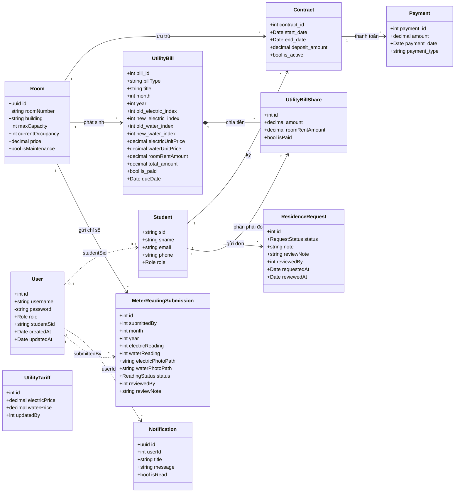

Sơ đồ phân lớp của một module (ví dụ duyệt chỉ số điện nước), áp dụng chung cho các module:

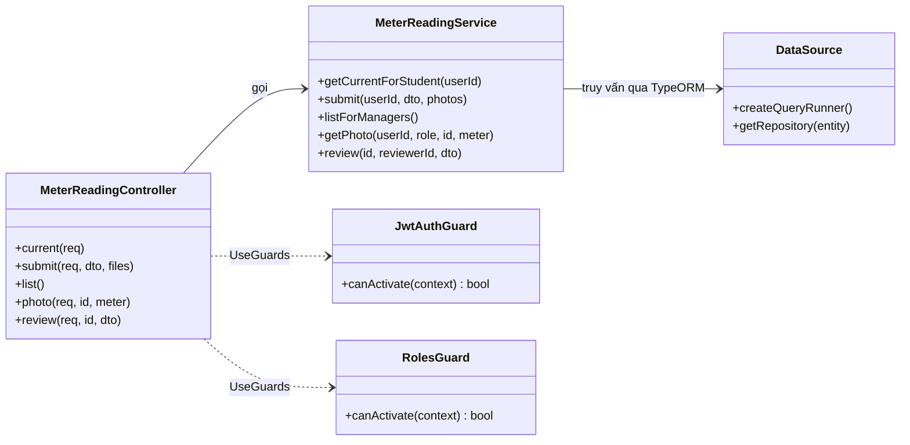

---

## 7. Sơ đồ thuật toán (Đề 2b)

### 7.1 Đăng nhập (US-03)

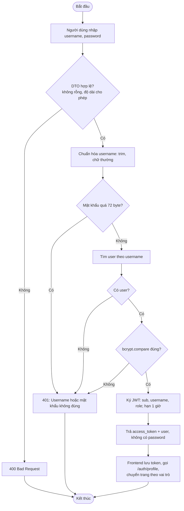

### 7.2 Sinh viên gửi đơn đăng ký ở (US-07, US-08)

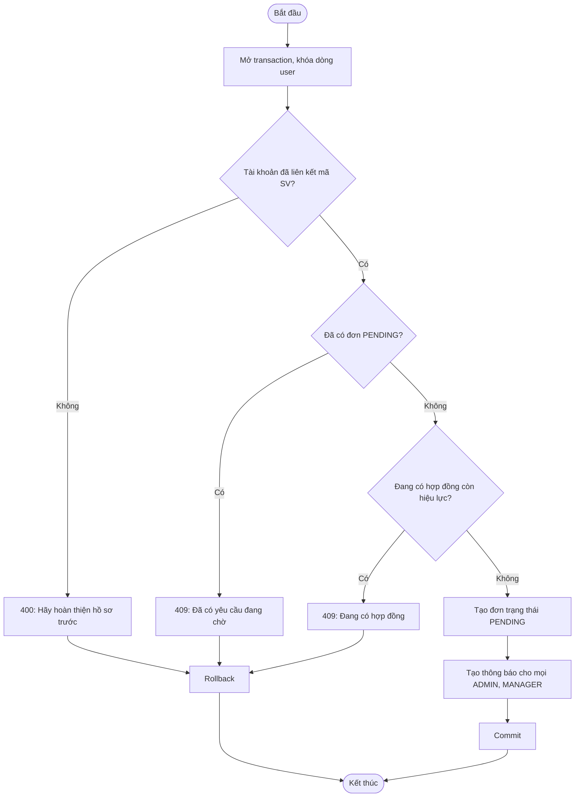

### 7.3 Cán bộ duyệt đơn đăng ký ở (US-15)

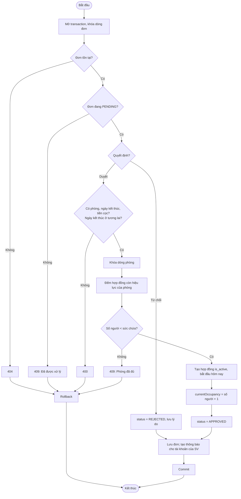

### 7.4 Sinh viên gửi chỉ số điện nước (US-11)

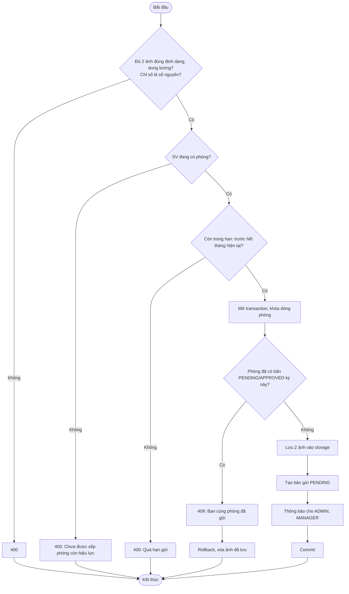

### 7.5 Duyệt chỉ số, tạo hóa đơn và chia tiền (US-17, US-18)

Công thức (hàm trong `meter-reading-calculations.ts`):

* Tiền điện nước = (điện mới − điện cũ) × giá điện + (nước mới − nước cũ) × giá nước, làm tròn 2 chữ số.
* Tổng hóa đơn = tiền điện nước + giá phòng.
* Chia đều theo số SV có hợp đồng còn hiệu lực; tính bằng đơn vị xu, phần dư 1 xu chia cho các SV đầu tiên theo mã SV tăng dần, nên tổng các phần luôn bằng tổng hóa đơn.
* Hạn đóng = ngày 10 tháng kế tiếp.

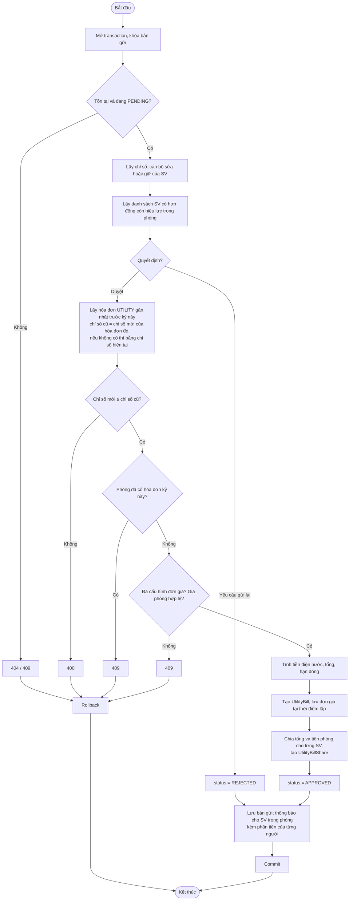

### 7.6 Đánh dấu đã đóng tiền (US-19)

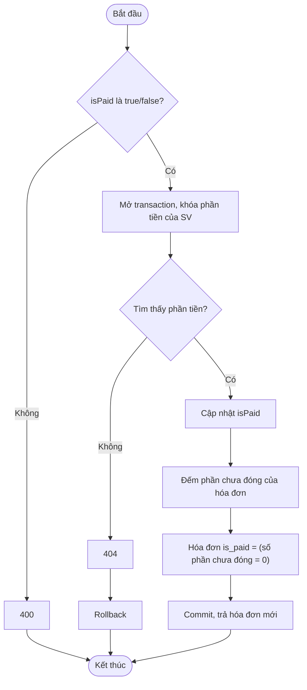

### 7.7 Lập hợp đồng (US-16)

Hợp đồng tạo với `is_active = false` bỏ qua kiểm tra trùng thời gian, bảo trì và sức chứa.

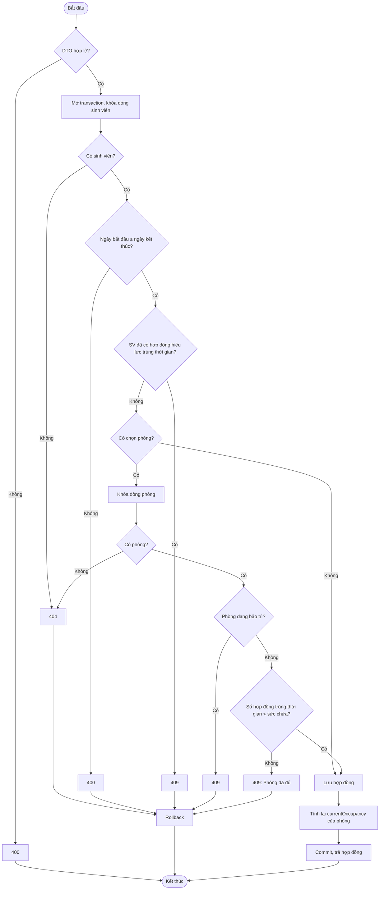

### 7.8 Gia hạn, kết thúc, thanh lý hợp đồng (US-16)

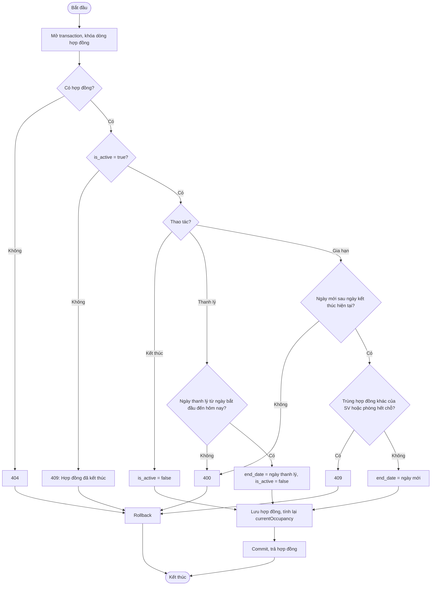

### 7.9 Ghi nhận thanh toán (US-21)

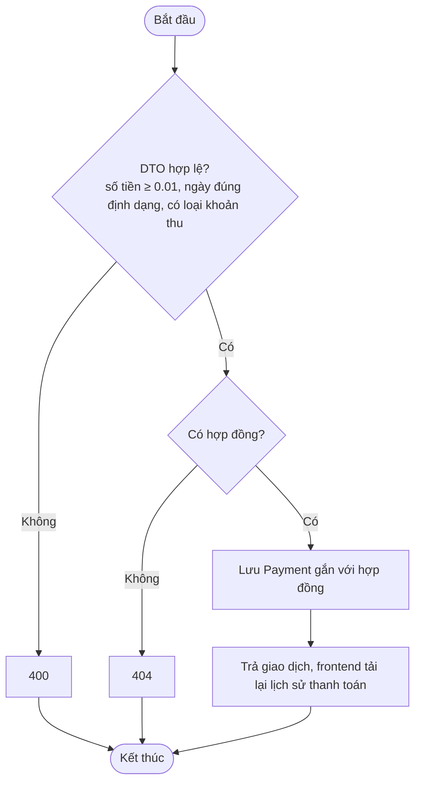

---

## 8. Điểm cần nhóm xem lại

* Tên cột và khóa chính khác nhau (UUID, số tự tăng, mã chuỗi; camelCase lẫn snake_case). Nhóm giữ nguyên (checklist 2.4).
* User–Student là liên kết logic qua `studentSid`, không có khóa ngoại; `Student.role` thừa. Nhóm giữ nguyên (checklist 2.5).
* Hợp đồng chỉ có `is_active`, không có trạng thái `EXPIRED` (checklist 2.6). Quá hạn tính theo ngày ở frontend, không có tác vụ tự chuyển; `currentOccupancy` chỉ tính lại khi có thao tác ghi nên có thể cũ sau ngày hết hạn (checklist 5.2).
* Chưa có xóa mềm: còn lịch sử thì chặn xóa (checklist 5.3).
* Duyệt đơn đăng ký ở chưa kiểm `isMaintenance` ở backend, chỉ frontend loại phòng bảo trì khi chọn.
* `POST /payments` chỉ kiểm hợp đồng tồn tại, không đối chiếu với hóa đơn và không đổi `UtilityBillShare.isPaid`. Hai cách theo dõi tiền đang độc lập.
