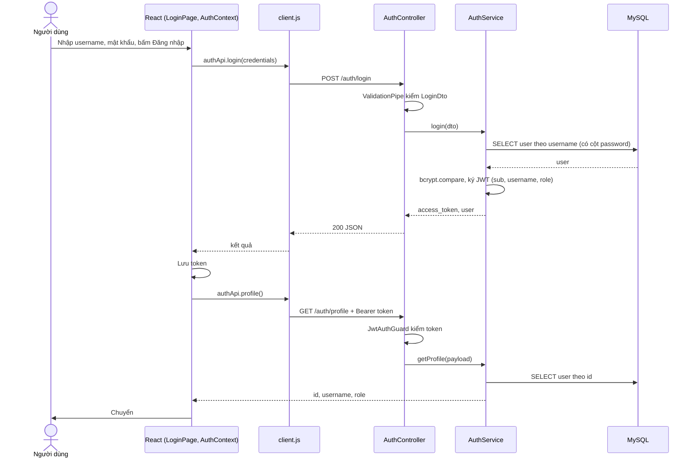
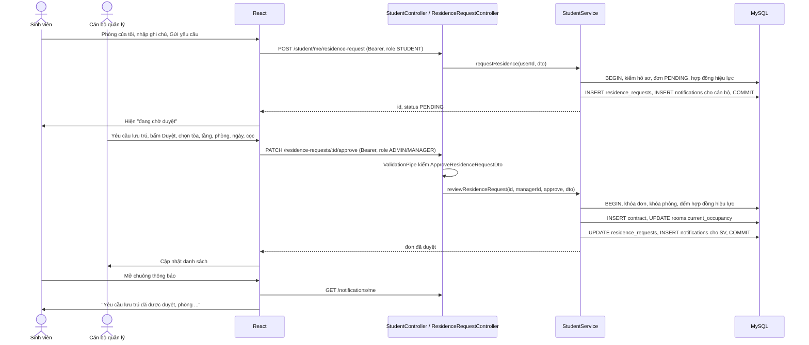
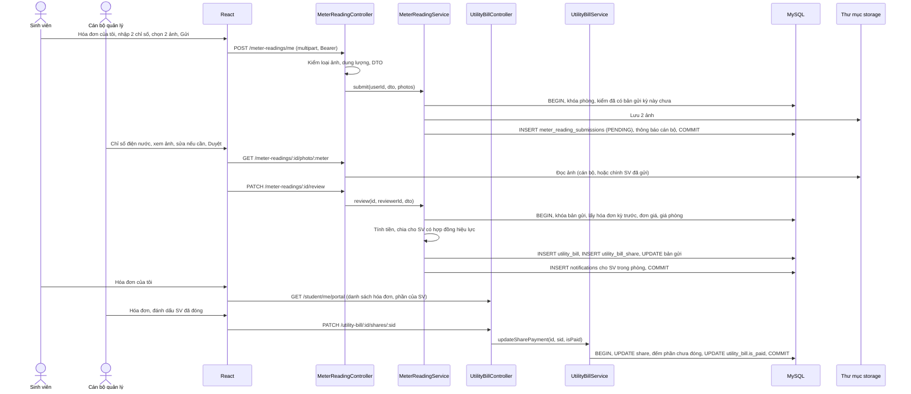
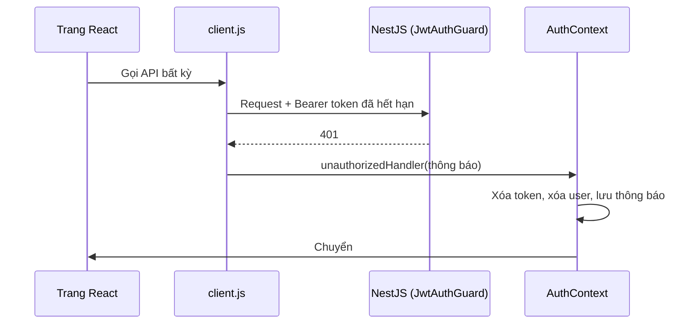

# Wireframe và luồng xử lý thông tin — KTX Care

Trạng thái: bản nháp, chờ nhóm duyệt (checklist 2.14, phục vụ Đề 3a, 3b; Đề 5a yêu cầu code giao diện khớp wireframe này).

* Wireframe vẽ theo bố cục giao diện đang có trên `main` ngày 01/11/2026 (sau commit `8514e3d`).
* Trang chủ sẽ đổi theo mẫu React Native và chuyển sang `react-bootstrap` (checklist 2.10, 2.16, 6.12). Khi đổi xong phải vẽ lại phần 1.1.
* Mã US-xx lấy từ `docs/user-stories.md`. Sơ đồ luồng viết bằng Mermaid, xuất hình qua https://mermaid.live.

---

## 1. Wireframe (Đề 3a)

### 1.1 Trang chủ (khách, US-01)

```text
+--------------------------------------------------------------------+
| [K] KTX Care     Giới thiệu  Mục đích  ...  Cộng đồng   [Đăng nhập] |
+--------------------------------------------------------------------+
|                                                                    |
|                         KTX Care                                   |
|            Câu giới thiệu ngắn về hệ thống ký túc xá               |
|          [ Bắt đầu sử dụng ]   [ Tìm hiểu thêm ]                    |
|                                                                    |
|      [ hình minh họa: laptop + điện thoại + trình duyệt ]          |
+--------------------------------------------------------------------+
|  GIỚI THIỆU: "Một mái nhà chung, ..."  + đoạn mô tả                 |
+--------------------------------------------------------------------+
|  MỤC ĐÍCH: "Để cuộc sống ở ký túc xá ..."                           |
|  +----------------+  +----------------+  +----------------+        |
|  | 01 Không gian  |  | 02 Thông tin   |  | 03 Lấy sinh    |        |
|  | được tổ chức   |  | minh bạch      |  | viên làm trọng |        |
|  +----------------+  +----------------+  +----------------+        |
+--------------------------------------------------------------------+
|  KẾT NỐI BAN QUẢN LÝ  ...                       [ Đăng nhập ]       |
+--------------------------------------------------------------------+
| Footer: liên hệ, Hệ thống quản lý ký túc xá                         |
+--------------------------------------------------------------------+
```

### 1.2 Đăng nhập / đăng ký (US-02, US-03)

```text
+------------------------------------------+
| [K] KTX Care                             |
|                                          |
|   +----------------------------------+   |
|   |  [K]                             |   |
|   |  CỔNG QUẢN LÝ KÝ TÚC XÁ          |   |
|   |  Đăng nhập hệ thống              |   |
|   |  (thông báo phiên hết hạn nếu có)|   |
|   |  Tên đăng nhập [______________]  |   |
|   |  Mật khẩu      [______________]  |   |
|   |  (lỗi đăng nhập nếu có)          |   |
|   |  [        Đăng nhập          ]   |   |
|   |  Chưa có tài khoản? Đăng ký      |   |
|   +----------------------------------+   |
|                                          |
| KTX Care · Hệ thống quản lý ký túc xá    |
+------------------------------------------+
```

Trang đăng ký giống trên, thêm ô "Xác nhận mật khẩu"; đăng ký xong báo thành công, về đăng nhập.

### 1.3 Khung chung sau khi đăng nhập

Máy tính (rộng hơn 720px):

```text
+------------+-------------------------------------------------------+
| [K] KTX    | KTX Care / Tên trang          (chuông) [A] tên  vai trò|
| Care       |                                          [Đăng xuất]  |
|            +-------------------------------------------------------+
| MENU CHÍNH | Banner chào mừng (chỉ ở trang chủ của vai trò)        |
| > Mục 1    +-------------------------------------------------------+
|   Mục 2    | NHÃN TRANG                                            |
|   Mục 3    | Tiêu đề trang                     [ Nút hành động ]   |
|   ...      | Mô tả ngắn                                            |
|            |                                                       |
| Cần hỗ trợ?|   Nội dung trang (bảng, thẻ, form)                    |
| Liên hệ... |   + trạng thái: đang tải / rỗng / lỗi [Thử lại]       |
|            +-------------------------------------------------------+
| ● Hệ thống |  Footer                                               |
+------------+-------------------------------------------------------+
```

Điện thoại (375px): sidebar chuyển thành thanh trên cùng, menu xếp ngang, nội dung một cột.

```text
+-------------------------------+
| [K] KTX Care                  |
| Mục 1 | Mục 2 | Mục 3 | ...   |
+-------------------------------+
| Tên trang      (chuông) [A]   |
+-------------------------------+
| Tiêu đề trang                 |
| [ Nút hành động ]             |
| Nội dung một cột              |
+-------------------------------+
```

Menu theo vai trò (checklist 6.4):

* ADMIN: Tổng quan, Tòa nhà & Phòng, Yêu cầu lưu trú, Hợp đồng, Hóa đơn, Chỉ số điện nước, Cài đặt
* MANAGER: như ADMIN, không có Cài đặt
* STUDENT: Hồ sơ cá nhân, Phòng của tôi, Hóa đơn của tôi, Liên hệ quản lý

### 1.4 Bảng điều khiển (cán bộ, US-20)

```text
| TỔNG QUAN HOẠT ĐỘNG                                  [ngày hôm nay] |
| Bảng điều khiển                                                     |
| +-----------+ +-----------+ +-----------+ +-----------+             |
| | Tổng số   | | Sinh viên | | Hợp đồng  | | Hóa đơn   |             |
| | phòng     | | lưu trú   | | hiệu lực  | | chưa thu  |             |
| +-----------+ +-----------+ +-----------+ +-----------+             |
| +------------------------------+ +-------------------------------+ |
| | Công suất phòng   xx%        | | Hóa đơn gần đây   Xem tất cả  | |
| | [=========-------]           | | - Phòng A101  kỳ 10/2026  ... | |
| | lối tắt: Phòng, Hợp đồng...  | | - ...                         | |
| +------------------------------+ +-------------------------------+ |
```

### 1.5 Tòa nhà & Phòng (cán bộ, US-14)

```text
| SƠ ĐỒ TÒA NHÀ                                     [ + Thêm phòng ]  |
| Tòa nhà & Phòng                                                     |
| [Tòa: tất cả v]  [Tìm phòng...........]                             |
| +-------------+ +-------------+                                     |
| | Tòa A    >  | | Tòa B    >  |   (chọn tòa để xem theo tầng)       |
| | 12/20 chỗ   | |  8/16 chỗ   |                                     |
| +-------------+ +-------------+                                     |
| Tầng 1                                                              |
| +--------+ +--------+ +--------+                                    |
| | A101   | | A102   | | A103   |  thẻ phòng: số người/sức chứa,     |
| | 2/4    | | 4/4    | | 0/4    |  giá; bấm để sửa / xóa             |
| +--------+ +--------+ +--------+                                    |
```

### 1.6 Yêu cầu lưu trú (cán bộ, US-15)

```text
| TIẾP NHẬN SINH VIÊN                                                 |
| Yêu cầu lưu trú                                                     |
| +-----------------------------------------------------------------+ |
| | Sinh viên (tên, mã, SĐT) | Ngày gửi | Ghi chú | Trạng thái |      |
| |                    [Duyệt / xếp phòng]  [Từ chối]   (khi PENDING) |
| +-----------------------------------------------------------------+ |

Hộp "Duyệt yêu cầu và phân phòng":
+---------------------------------------------+
| Tòa  [ A v ]   Tầng [ 1 v ]                 |
| Phòng: [A101 2/4] [A103 0/4]  (chỉ còn chỗ) |
| Ngày kết thúc lưu trú [dd/mm/yyyy]          |
| Tiền đặt cọc (₫)      [__________]          |
| Ghi chú               [__________]          |
|                 [ Hủy ]  [ Duyệt ]          |
+---------------------------------------------+
```

### 1.7 Hóa đơn & Khoản thu (cán bộ, US-18, US-19)

```text
| THU CHI & CÔNG NỢ                         [ + Tạo khoản thu ]       |
| Hóa đơn & Khoản thu                                                 |
| [Tìm hóa đơn......]                                                 |
| +-----------------------------------------------------------------+ |
| | Mã HĐ | Phòng | Khoản thu | Kỳ | Hạn | Tiền phòng | Điện nước    | |
| | Điện/nước tiêu thụ | Tổng | Trạng thái | Ảnh | [Sửa] [Xóa: ADMIN]| |
| +-----------------------------------------------------------------+ |
| Phần từng sinh viên:                                    |
|   SV001  350.000 ₫  [x] Đã đóng                                     |
|   SV002  350.000 ₫  [ ] Chưa đóng   [Nhắc thanh toán] [Liên hệ]     |
```

### 1.8 Chỉ số điện nước (cán bộ, US-17, US-22)

```text
| CHỐT CHỈ SỐ HÀNG THÁNG                                              |
| Xác nhận chỉ số điện nước                                           |
| Đơn giá điện nước: Giá điện [____] Giá nước [____]  [Lưu]          |
| Ảnh và chỉ số chờ xác nhận                                          |
| +-----------------------------------------------------------------+ |
| | Phòng A101 kỳ 10/2026  [ảnh điện] [ảnh nước]                    | |
| | Điện (kWh) [1234]  Nước (m³) [56]  Ghi chú [____]                | |
| | [ Yêu cầu gửi lại ]                         [ Duyệt, tạo hóa đơn ]| |
| +-----------------------------------------------------------------+ |
```

### 1.9 Cổng sinh viên (US-07 đến US-13)

Hồ sơ cá nhân:

```text
| CỔNG SINH VIÊN                                                      |
| Hồ sơ cá nhân                                                       |
| Hoàn thiện hồ sơ cá nhân                                            |
| Mã sinh viên [______]  Họ và tên [__________]                       |
| Email [______________] Số điện thoại [__________]     [ Lưu ]       |
```

Phòng của tôi:

```text
| Phòng của tôi                                                       |
| Chưa có phòng:  Đăng ký lưu trú                                     |
|   Ghi chú cho quản lý (không bắt buộc) [__________]  [ Gửi yêu cầu ]|
|   (sau khi gửi: trạng thái chờ duyệt / đã duyệt / lý do từ chối)    |
| Đã có phòng:   Phòng A101, Tòa A, hợp đồng đến dd/mm/yyyy           |
|   Các bạn cùng phòng: SV002 ..., SV003 ...                          |
```

Hóa đơn của tôi:

```text
| Hóa đơn của tôi                                                     |
| Hóa đơn cần thanh toán                                              |
| +-----------------------------------------------------------------+ |
| | Kỳ | Phòng | Phần của tôi | Hạn đóng | Trạng thái | Biên lai    | |
| +-----------------------------------------------------------------+ |
| Gửi chỉ số điện nước (kỳ hiện tại, hạn cuối tháng)                  |
|   Chỉ số điện (kWh) [____] [Chọn ảnh]                               |
|   Chỉ số nước (m³)  [____] [Chọn ảnh]                 [ Gửi ]       |
```

Liên hệ quản lý: 2 thẻ Email ban quản lý [Soạn email], Điện thoại [Gọi].

---

## 2. Luồng xử lý thông tin (Đề 3b)

### 2.1 Các tầng mà một request đi qua

```text
Trình duyệt
  Trang React (pages/*)  ->  hàm gọi API (api/*.api.js)
  ->  api/client.js: gắn "Authorization: Bearer <token>", xử lý 401/403
        |
        | HTTP JSON (CORS chỉ cho origin cấu hình)
        v
NestJS
  main.ts: CORS, ValidationPipe toàn cục (whitelist, forbidNonWhitelisted)
  -> Controller (@Controller)  -> JwtAuthGuard (kiểm JWT)  -> RolesGuard (@Roles)
  -> DTO + class-validator (400 nếu sai)
  -> Service (nghiệp vụ, transaction khi ghi nhiều bảng)
  -> TypeORM Repository / QueryRunner
        |
        v
MySQL 8 (Aiven, SSL)
  -> kết quả quay ngược lại: Service trả object, Controller trả JSON
  -> client.js đọc JSON, ném lỗi có message tiếng Việt nếu !ok
  -> trang React cập nhật state, hiển thị dữ liệu / lỗi
```

### 2.2 Đăng nhập và mở trang theo vai trò (US-03)



### 2.3 Đăng ký ở và duyệt xếp phòng (US-08, US-15, US-06)



### 2.4 Chỉ số điện nước, hóa đơn và đóng tiền (US-11, US-17, US-18, US-10, US-19)



Ghi chú: `GET /student/me/portal` thuộc StudentController, vẽ chung vào nhánh hóa đơn cho gọn.

### 2.5 Phiên hết hạn (checklist 6.3, Đề 4c)


