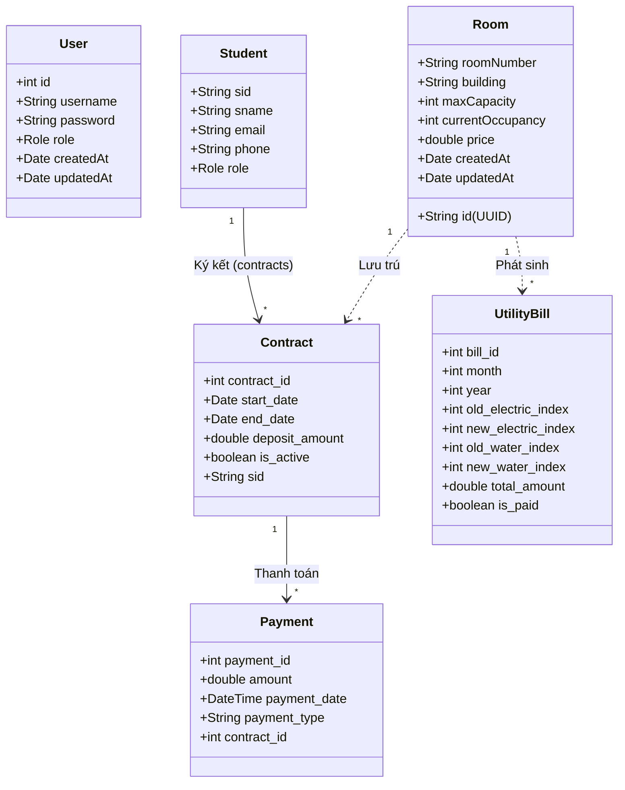

# HỆ THỐNG QUẢN LÝ KÝ TÚC XÁ SINH VIÊN (KTX CARE)
> **Bài tập lớn môn:** Phát triển Ứng dụng Web Nâng cao  
> **Repository:** [NhomBTL-Webnangcao-Tdz123](https://github.com/NhomBTL-Webnangcao-Tdz/NhomBTL-Webnangcao-Tdz123.git)

---

## 📌 1. Thông Tin Nhóm Phát Triển

- **Giảng viên hướng dẫn:** `@lethunguyen`
- **Danh sách thành viên:**
  1. **Chu Thanh Tân** - MSSV: `23010165`
  2. **Đặng Hải Nam** - MSSV: `23010068`
  3. **Lê Hải Sơn** - MSSV: `23010722`

---

## 📖 2. Tổng Quan Dự Án

Hệ thống **KTX Care** là giải pháp phần mềm quản lý ký túc xá toàn diện dành cho các trường đại học, cao đẳng. Hệ thống hỗ trợ ban quản lý ký túc xá và sinh viên thực hiện các quy trình nghiệp vụ lưu trú một cách tự động, minh bạch và chính xác:

- **Quản lý phòng ở:** Quản lý danh mục phòng, tòa nhà, sức chứa tối đa, số lượng người đang lưu trú và định mức giá thuê.
- **Quản lý hồ sơ sinh viên:** Theo dõi thông tin cá nhân, mã sinh viên, email, số điện thoại của sinh viên nội trú.
- **Quản lý hợp đồng thuê phòng:** Lập và theo dõi hợp đồng lưu trú, thời hạn hợp đồng, tiền đặt cọc và trạng thái hiệu lực.
- **Quản lý hóa đơn điện nước:** Ghi nhận chỉ số điện nước đầu kỳ, cuối kỳ của từng phòng, tự động tính tổng tiền và theo dõi thanh toán.
- **Quản lý thanh toán:** Ghi nhận các đợt đóng tiền cọc, tiền phòng của sinh viên gắn liền với hợp đồng.
- **Xác thực và Phân quyền (Auth & RBAC):** Đăng ký, đăng nhập bảo mật bằng JWT và Bcrypt, phân quyền chặt chẽ giữa Quản trị viên (`ADMIN`), Quản lý (`MANAGER`), và Sinh viên (`STUDENT`).

---

## 🛠 3. Kiến Trúc Công Nghệ (Tech Stack)

### 3.1. Backend
- **Framework:** [NestJS v12](https://nestjs.com/) (Node.js framework xây dựng trên TypeScript, kiến trúc module hóa).
- **ORM:** [TypeORM v1.1](https://typeorm.io/) (Data Source & Repository Pattern).
- **Cơ sở dữ liệu:** MySQL 8+ (hỗ trợ triển khai Cloud qua Aiven Database hoặc Local MySQL Server).
- **Authentication & Security:**
  - `@nestjs/jwt` cho việc cấp phát và thẩm định JSON Web Tokens.
  - `bcrypt` cho mã hóa/băm mật khẩu bảo mật một chiều.
  - Custom `JwtAuthGuard` kế thừa `CanActivate` để trích xuất và xác minh Bearer Token.
  - Custom `RolesGuard` cùng Decorator `@Roles(...)` triển khai kiểm soát quyền truy cập dựa trên vai trò (RBAC).
  - `class-validator` & `class-transformer` kết hợp NestJS Global `ValidationPipe` để validate và chuẩn hóa payload DTO.
- **Tooling & Testing:**
  - Linter: `oxlint` (siêu nhanh, hiện đại).
  - Formatting: `prettier`.
  - Testing: `jest`, `ts-jest`, `supertest`.

### 3.2. Frontend
- **Thư viện chính:** [React 19](https://react.dev/) (khởi tạo qua Create React App / `react-scripts`).
- **Giao diện & UI Framework:** [Bootstrap 5](https://getbootstrap.com/) & [React-Bootstrap](https://react-bootstrap.netlify.app/).
- **Kiến trúc điều hướng:** Single Page Application (SPA) với cơ chế Hash-based Routing (`#overview`, `#rooms`, `#students`, `#contracts`, `#utility-bills`).
- **Styling:** CSS variables, Responsive Admin Shell layout với Sidebar, Topbar và Module cards hiện đại.

---

## 📁 4. Cấu Trúc Thư Mục Chi Tiết Toàn Bộ Project

```text
NhomBTL-Webnangcao-Tdz123/
│
├── .gitignore                          # Cấu hình bỏ qua git ở thư mục gốc
├── baocao-bt-th-2.md                   # Báo cáo thực hành số 2 (Phân tích bài toán, thực thể, UML)
├── readme.md                           # Tài liệu hướng dẫn và mô tả cấu trúc dự án (File này)
│
└── quan-ly-ktx/                        # Thư mục mã nguồn chính của ứng dụng
    │
    ├── backend/                        # === BACKEND SOURCE (NestJS + TypeORM) ===
    │   ├── src/
    │   │   ├── main.ts                 # Điểm khởi chạy backend (khởi tạo app, ValidationPipe, cổng 5000)
    │   │   ├── app.module.ts           # Root module kết nối Database, Auth và các feature modules
    │   │   ├── app.controller.ts       # Controller mặc định kiểm tra trạng thái app
    │   │   ├── app.controller.spec.ts  # Unit test cho AppController
    │   │   ├── app.service.ts          # Service logic mặc định
    │   │   │
    │   │   ├── auth/                   # Phân hệ Xác thực & Phân quyền
    │   │   │   ├── auth.module.ts      # Module xác thực, cấu hình JwtModule global
    │   │   │   ├── auth.controller.ts  # Endpoints: /auth/register, /auth/login, /auth/profile
    │   │   │   ├── auth.service.ts     # Nghiệp vụ xử lý đăng ký, mã hóa mật khẩu, tạo token
    │   │   │   ├── dto/
    │   │   │   │   ├── login.dto.ts    # DTO xác thực thông tin đăng nhập
    │   │   │   │   └── register.dto.ts # DTO đăng ký tài khoản (validate length, string)
    │   │   │   ├── entities/
    │   │   │   │   ├── user.entity.ts  # Thực thể User (id, username, password hash, role, timestamps)
    │   │   │   │   ├── user.provider.ts# Cung cấp USER_REPOSITORY qua DataSource
    │   │   │   │   └── users.service.ts# Truy vấn database liên quan tới User
    │   │   │   └── guards/
    │   │   │       └── jwt-auth.guard.ts # Custom Guard xác thực Bearer JWT từ Authorization header
    │   │   │
    │   │   ├── common/                 # Các tiện ích và cấu trúc dùng chung toàn hệ thống
    │   │   │   ├── base.entity.ts      # Abstract Base Entity (id UUID, created_at, updated_at)
    │   │   │   ├── role.enum.ts        # Định nghĩa enum Role (ADMIN, STUDENT, MANAGER)
    │   │   │   ├── roles.decorator.ts  # Custom Decorator @Roles(...) định nghĩa metadata quyền
    │   │   │   └── roles.guard.ts      # CanActivate Guard kiểm tra quyền của User khớp với Endpoint
    │   │   │
    │   │   ├── database/               # Cấu hình kết nối cơ sở dữ liệu
    │   │   │   ├── database.module.ts  # Module export DATA_SOURCE provider
    │   │   │   └── database.providers.ts # Thiết lập TypeORM DataSource kết nối MySQL (hỗ trợ SSL Aiven)
    │   │   │
    │   │   └── modules/                # Các phân hệ nghiệp vụ chính của KTX
    │   │       ├── room/               # Module Quản lý Phòng
    │   │       │   ├── dto/
    │   │       │   │   ├── create-room.dto.ts # Validation khi tạo phòng mới
    │   │       │   │   └── update-room.dto.ts # PartialType cập nhật thông tin phòng
    │   │       │   ├── room.entity.ts     # Thực thể Room (roomNumber, building, maxCapacity, price...)
    │   │       │   ├── room.provider.ts   # ROOM_REPOSITORY provider
    │   │       │   ├── room.service.ts    # CRUD nghiệp vụ phòng
    │   │       │   ├── room.controller.ts # REST API /rooms (bảo vệ bởi JwtAuthGuard & RolesGuard)
    │   │       │   └── room.module.ts     # Khai báo RoomModule
    │   │       │
    │   │       ├── student/            # Module Quản lý Sinh viên
    │   │       │   ├── student.entity.ts    # Thực thể Student (sid, sname, email, phone, role...)
    │   │       │   ├── student.provider.ts  # STUDENT_REPOSITORY provider
    │   │       │   ├── student.service.ts   # CRUD nghiệp vụ sinh viên
    │   │       │   ├── student.controller.ts# REST API /student
    │   │       │   └── student.module.ts    # Khai báo StudentModule
    │   │       │
    │   │       ├── contract/           # Module Quản lý Hợp đồng thuê phòng
    │   │       │   ├── contract.entity.ts    # Thực thể Contract (thời hạn, tiền cọc, liên kết Student)
    │   │       │   ├── contract.provider.ts  # CONTRACT_REPOSITORY provider
    │   │       │   ├── contract.service.ts   # CRUD nghiệp vụ hợp đồng
    │   │       │   ├── contract.controller.ts# REST API /contract
    │   │       │   └── contract.module.ts    # Khai báo ContractModule
    │   │       │
    │   │       ├── utility-bill/       # Module Hóa đơn Điện Nước
    │   │       │   ├── utility-bill.entity.ts    # Thực thể UtilityBill (tháng, năm, chỉ số cũ/mới, tổng tiền)
    │   │       │   ├── utility-bill.provider.ts  # UTILITY_BILL_REPOSITORY provider
    │   │       │   ├── utility-bill.service.ts   # CRUD nghiệp vụ tính tiền điện nước
    │   │       │   ├── utility-bill.controller.ts# REST API /utility-bill
    │   │       │   └── utility-bill.module.ts    # Khai báo UtilityBillModule
    │   │       │
    │   │       └── payment/            # Module Quản lý Thanh toán
    │   │           ├── payment.entity.ts   # Thực thể Payment (số tiền, ngày đóng, loại tiền, contract)
    │   │           └── payment.provider.ts # PAYMENT_REPOSITORY provider
    │   │
    │   ├── test/                       # E2E test cho backend
    │   │   ├── app.e2e-spec.ts         # Test kịch bản luồng ứng dụng
    │   │   └── jest-e2e.json           # Cấu hình Jest e2e
    │   ├── .prettierrc                 # Quy chuẩn định dạng mã nguồn Prettier
    │   ├── jest.config.ts              # Cấu hình kiểm thử Jest
    │   ├── nest-cli.json               # Cấu hình NestJS CLI
    │   ├── oxlint.json                 # Cấu hình Oxlint linter
    │   ├── package.json                # Dependencies và npm scripts của backend
    │   ├── tsconfig.json               # Cấu hình TypeScript compiler
    │   └── tsconfig.build.json         # Cấu hình TypeScript dành cho build production
    │
    └── frontend/                       # === FRONTEND SOURCE (React 19 + Bootstrap) ===
        ├── public/
        │   ├── favicon.ico             # Favicon ứng dụng
        │   ├── index.html              # Trang HTML gốc chứa thẻ <div id="root">
        │   ├── manifest.json           # Cấu hình PWA Web App Manifest
        │   └── robots.txt              # Cấu hình crawler web
        ├── src/
        │   ├── components/             # Thư mục chứa các UI component tái sử dụng
        │   ├── App.js                  # Component chính chứa Navigation Shell, Sidebar, Topbar, routing hash
        │   ├── App.css                 # Giao diện chính của hệ thống quản lý KTX Care
        │   ├── App.test.js             # Test cơ bản cho App component
        │   ├── Footer.js               # Component chân trang
        │   ├── index.js                # Điểm khởi chạy React, gắn App vào DOM
        │   ├── index.css               # Reset CSS và thiết lập typography toàn cục
        │   ├── reportWebVitals.js      # Đo lường hiệu năng Web Vitals
        │   └── setupTests.js           # Khởi tạo môi trường Jest DOM testing
        ├── package.json                # Dependencies và npm scripts của frontend
        └── README.md                   # Tài liệu Create React App gốc
```

---

## 🗄 5. Thiết Kế Cơ Sở Dữ Liệu & Mô Hình Thực Thể

### 5.1. Sơ đồ Quan hệ Lớp (UML Class Diagram)



### 5.2. Danh sách các vai trò (Roles) trong hệ thống
Được định nghĩa tại enum `Role` (`src/common/role.enum.ts`):
1. **`ADMIN`**: Quản trị viên cao nhất hệ thống, toàn quyền quản lý phòng, sinh viên, hợp đồng và người dùng.
2. **`MANAGER`**: Nhân viên ban quản lý KTX, quản lý phòng, lập hóa đơn điện nước và giám sát lưu trú.
3. **`STUDENT`**: Sinh viên đăng ký và theo dõi thông tin lưu trú của chính mình.

---

## 🔌 6. Danh Sách API Endpoints

### 6.1. Authentication Module (`/auth`)
| Method | Endpoint | Yêu cầu xác thực | Mô tả |
| :--- | :--- | :--- | :--- |
| `POST` | `/auth/register` | Công khai | Đăng ký tài khoản mới (mặc định vai trò `STUDENT`) |
| `POST` | `/auth/login` | Công khai | Đăng nhập và nhận `access_token` (JWT) |
| `GET` | `/auth/profile` | Bearer Token (`JwtAuthGuard`) | Lấy thông tin tài khoản người dùng đang đăng nhập |

### 6.2. Room Module (`/rooms`)
> Được bảo vệ bởi `@UseGuards(JwtAuthGuard, RolesGuard)` và phân quyền `@Roles(Role.ADMIN, Role.MANAGER)`.

| Method | Endpoint | Quyền hạn | Mô tả |
| :--- | :--- | :--- | :--- |
| `POST` | `/rooms` | `ADMIN`, `MANAGER` | Tạo phòng mới |
| `GET` | `/rooms` | `ADMIN`, `MANAGER` | Lấy danh sách toàn bộ phòng |
| `GET` | `/rooms/:id` | `ADMIN`, `MANAGER` | Xem chi tiết thông tin một phòng theo ID |
| `PATCH`| `/rooms/:id` | `ADMIN`, `MANAGER` | Cập nhật thông tin phòng |
| `DELETE`| `/rooms/:id`| `ADMIN`, `MANAGER` | Xóa phòng khỏi hệ thống |

### 6.3. Student Module (`/student`)
| Method | Endpoint | Mô tả |
| :--- | :--- | :--- |
| `GET` | `/student` | Lấy danh sách tất cả sinh viên |
| `GET` | `/student/:id` | Lấy thông tin sinh viên theo mã `sid` |
| `POST` | `/student` | Thêm mới hồ sơ sinh viên |
| `PUT` | `/student/:id` | Cập nhật hồ sơ sinh viên |
| `DELETE` | `/student/:id` | Xóa sinh viên |

### 6.4. Contract Module (`/contract`)
| Method | Endpoint | Mô tả |
| :--- | :--- | :--- |
| `GET` | `/contract` | Lấy danh sách tất cả hợp đồng thuê phòng |
| `GET` | `/contract/:id` | Lấy chi tiết hợp đồng theo mã `contract_id` |
| `POST` | `/contract` | Tạo hợp đồng thuê phòng mới |
| `PUT` | `/contract/:id` | Cập nhật điều khoản/thời hạn hợp đồng |
| `DELETE` | `/contract/:id` | Hủy hoặc xóa hợp đồng |

### 6.5. Utility Bill Module (`/utility-bill`)
| Method | Endpoint | Mô tả |
| :--- | :--- | :--- |
| `GET` | `/utility-bill` | Lấy danh sách hóa đơn điện nước |
| `GET` | `/utility-bill/:id` | Xem chi tiết hóa đơn theo mã `bill_id` |
| `POST` | `/utility-bill` | Lập hóa đơn chỉ số điện nước mới |
| `PUT` | `/utility-bill/:id` | Cập nhật số điện/nước hoặc trạng thái thanh toán (`is_paid`) |
| `DELETE` | `/utility-bill/:id` | Xóa hóa đơn |

---

## 🚀 7. Hướng Dẫn Cài Đặt và Khởi Chạy

### 7.1. Yêu cầu tiên quyết (Prerequisites)
- [Node.js](https://nodejs.org/) phiên bản `>= 18.x` hoặc `>= 20.x`.
- Trình quản lý gói `npm` (đi kèm Node.js).
- MySQL Server cục bộ hoặc tài khoản MySQL trên Cloud (như [Aiven](https://aiven.io/)).

---

### 7.2. Cài đặt và Chạy Backend

1. **Di chuyển vào thư mục backend:**
   ```bash
   cd quan-ly-ktx/backend
   ```

2. **Cài đặt các gói phụ thuộc:**
   ```bash
   npm install
   ```

3. **Cấu hình biến môi trường (Tùy chọn):**
   Mặc định hệ thống đã có cấu hình fallback kết nối MySQL database trên Cloud. Để tùy chỉnh theo môi trường riêng của bạn, có thể thiết lập các biến môi trường:
   ```env
   PORT=5000
   DB_HOST=localhost
   DB_PORT=3306
   DB_USERNAME=root
   DB_PASSWORD=your_password
   DB_NAME=quan_ly_ktx
   JWT_SECRET=super-secret-jwt-key-quan-ly-ktx
   JWT_EXPIRES_IN=1h
   ```

4. **Khởi chạy máy chủ Backend:**
   - Chế độ phát triển (hot reload):
     ```bash
     npm run start:dev
     ```
   - Chế độ production build:
     ```bash
     npm run build
     npm run start:prod
     ```

5. **Kiểm tra trạng thái:**
   Máy chủ backend sẽ chạy tại địa chỉ: `http://localhost:5000`

---

### 7.3. Cài đặt và Chạy Frontend

1. **Di chuyển vào thư mục frontend:**
   ```bash
   cd quan-ly-ktx/frontend
   ```

2. **Cài đặt các gói phụ thuộc:**
   ```bash
   npm install
   ```

3. **Khởi chạy ứng dụng React:**
   ```bash
   npm start
   ```

4. **Trải nghiệm giao diện:**
   Mở trình duyệt truy cập: `http://localhost:3000`  
   Giao diện quản lý KTX Care hỗ trợ điều hướng nhanh qua các menu chức năng:
   - `#overview`: Bảng điều khiển tổng quan và truy cập nhanh.
   - `#rooms`: Quản lý danh sách và trạng thái phòng ở.
   - `#students`: Quản lý hồ sơ thông tin sinh viên nội trú.
   - `#contracts`: Theo dõi hợp đồng và thời hạn lưu trú.
   - `#utility-bills`: Quản lý chỉ số và hóa đơn tiền điện nước.

---

### 7.4. Các lệnh Script hữu ích

#### Tại thư mục `quan-ly-ktx/backend`:
- `npm run start:dev`: Chạy backend ở chế độ watch mode.
- `npm run build`: Biên dịch TypeScript sang JavaScript trong thư mục `dist`.
- `npm run lint`: Chạy oxlint kiểm tra lỗi cú pháp và code convention.
- `npm run format`: Tự động format mã nguồn theo chuẩn Prettier.
- `npm run test`: Chạy toàn bộ unit test với Jest.
- `npm run test:e2e`: Chạy kiểm thử tích hợp đầu cuối (end-to-end).

#### Tại thư mục `quan-ly-ktx/frontend`:
- `npm start`: Khởi động React Web App trên môi trường dev.
- `npm run build`: Đóng gói ứng dụng React tối ưu hóa cho môi trường production trong thư mục `build`.
- `npm test`: Khởi chạy runner kiểm thử tương tác.

---

## 🔒 8. Quy Ước Bảo Mật & Luồng Xác Thực

1. **Mật khẩu người dùng:** Không bao giờ lưu dạng bản rõ (plaintext). Luôn được băm bằng thuật toán `bcrypt` với muối (salt) tự sinh trước khi ghi vào bảng `users`.
2. **Xác thực JWT (Bearer Authentication):** Khi đăng nhập thành công qua `/auth/login`, client nhận về chuỗi JWT `access_token`. Client cần đính kèm token này vào header của các request tiếp theo:
   ```http
   Authorization: Bearer <access_token>
   ```
3. **Kiểm soát truy cập (Guards & RBAC):**
   - `JwtAuthGuard`: Giải mã và xác thực chữ ký token. Nếu token hết hạn hoặc không hợp lệ, lập tức trả về `401 Unauthorized`.
   - `RolesGuard`: Đọc metadata quyền được gắn qua `@Roles(...)` và đối chiếu với vai trò của user. Nếu không đủ quyền, trả về `403 Forbidden`.
4. **Validation Pipe Toàn Cục:** Bật `whitelist: true`, `forbidNonWhitelisted: true`, và `transform: true` giúp ngăn chặn triệt để tấn công Mass Assignment và kiểm soát chặt chẽ kiểu dữ liệu đầu vào.

---

## 🗺 9. Kế Hoạch Phát Triển Tiếp Theo (Roadmap)

- [x] Phân tích mô hình thực thể và thiết kế CSDL (Student, Room, Contract, UtilityBill, Payment).
- [x] Xây dựng Backend NestJS với kiến trúc module hóa và Database Providers.
- [x] Xây dựng Authentication (JWT + Bcrypt) và RBAC (Roles Guard).
- [x] Thiết kế giao diện ứng dụng quản lý ký túc xá (Admin Dashboard Shell, Responsive UI).
- [ ] Tích hợp gọi REST API trực tiếp từ giao diện React frontend (Axios/Fetch + React Context/Zustand quản lý phiên đăng nhập).
- [ ] Hoàn thiện quan hệ giữa các entity (liên kết khóa ngoại giữa `Room` với `Contract` và `UtilityBill`).
- [ ] Xây dựng hoàn chỉnh Controller và Service cho phân hệ thanh toán `Payment`.
- [ ] Bổ sung tính năng xuất báo cáo thống kê doanh thu, tỷ lệ lấp đầy phòng ở định dạng Excel/PDF.

