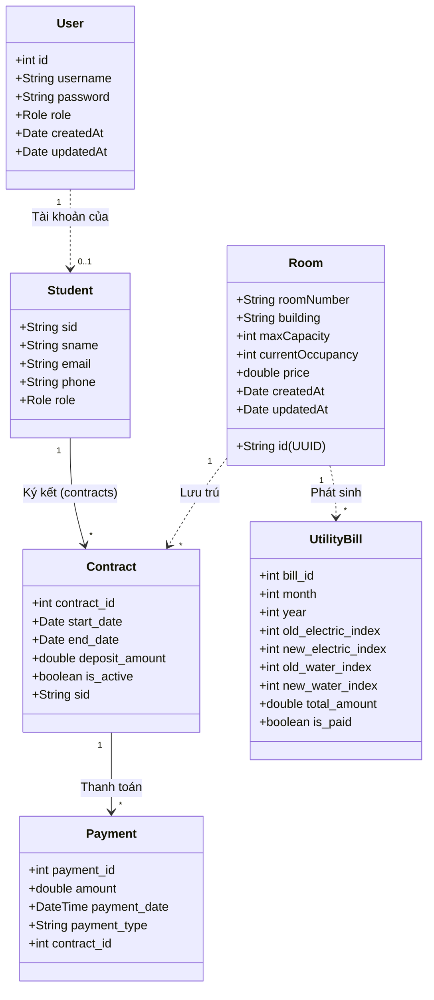

# HỆ THỐNG QUẢN LÝ KÝ TÚC XÁ SINH VIÊN (KTX CARE)
> **Bài tập lớn môn:** Phát triển Ứng dụng Web Nâng cao  
> **Repository:** [NhomBTL-Webnangcao-Tdz123](https://github.com/NhomBTL-Webnangcao-Tdz/NhomBTL-Webnangcao-Tdz123.git)

---

## 📌 1. Thông Tin Nhóm Phát Triển

- **Giảng viên hướng dẫn:** `@lethunguyen`
- **Danh sách thành viên:**
  1. **Chu Thanh Tân** - MSSV: `23010165`
  2. **Đặng Hải Nam** - MSSV: `23010068`
  3. **Lê Hải Sơn** - MSSV: `23010722`

---

## 📖 2. Tổng Quan Dự Án

Hệ thống **KTX Care** là giải pháp phần mềm quản lý ký túc xá dành cho các trường đại học, cao đẳng. Hệ thống hỗ trợ ban quản lý ký túc xá và sinh viên thực hiện các quy trình nghiệp vụ lưu trú một cách minh bạch và chính xác.

> Dự án đang phát triển. Tiến độ chi tiết từng phần xem tại [checklist.md](checklist.md).

- **Quản lý phòng ở:** Quản lý danh mục phòng, tòa nhà, sức chứa tối đa, số lượng người đang lưu trú và định mức giá thuê.
- **Quản lý hồ sơ sinh viên:** Theo dõi thông tin cá nhân, mã sinh viên, email, số điện thoại của sinh viên nội trú.
- **Quản lý hợp đồng thuê phòng:** Lập và theo dõi hợp đồng lưu trú, thời hạn hợp đồng, tiền đặt cọc và trạng thái hiệu lực.
- **Quản lý hóa đơn điện nước:** Ghi nhận chỉ số điện nước đầu kỳ, cuối kỳ của từng phòng và theo dõi thanh toán *(hiện tổng tiền còn nhập tay, chưa tự tính)*.
- **Quản lý thanh toán:** Ghi nhận các đợt đóng tiền cọc, tiền phòng của sinh viên gắn liền với hợp đồng *(đã có bảng dữ liệu, chưa có API)*.
- **Xác thực và Phân quyền (Auth & RBAC):** Đăng ký, đăng nhập bằng JWT và Bcrypt, phân quyền giữa Quản trị viên (`ADMIN`), Quản lý (`MANAGER`) và Sinh viên (`STUDENT`).

---

## 🛠 3. Kiến Trúc Công Nghệ (Tech Stack)

### 3.1. Backend
- **Framework:** [NestJS v12](https://nestjs.com/) (Node.js framework xây dựng trên TypeScript, kiến trúc module hóa).
- **ORM:** [TypeORM v1.1](https://typeorm.io/) (Data Source & Repository Pattern).
- **Cấu hình:** `@nestjs/config`, đọc biến môi trường từ file `quan-ly-ktx/backend/.env`.
- **Cơ sở dữ liệu:** MySQL 8+ (MySQL cài trên máy hoặc Cloud như Aiven, hỗ trợ SSL kèm chứng chỉ CA).
- **Authentication & Security:**
  - `@nestjs/jwt` cho việc cấp phát và thẩm định JSON Web Tokens.
  - `bcrypt` cho mã hóa/băm mật khẩu bảo mật một chiều.
  - Custom `JwtAuthGuard` kế thừa `CanActivate` để trích xuất và xác minh Bearer Token.
  - Custom `RolesGuard` cùng Decorator `@Roles(...)` triển khai kiểm soát quyền truy cập dựa trên vai trò (RBAC).
  - `class-validator` & `class-transformer` kết hợp NestJS Global `ValidationPipe` để validate và chuẩn hóa payload DTO.
- **Tooling & Testing:**
  - Linter: `oxlint` (siêu nhanh, hiện đại).
  - Formatting: `prettier`.
  - Testing: `jest`, `ts-jest`, `supertest`.

### 3.2. Frontend
- **Thư viện chính:** [React 19](https://react.dev/) (khởi tạo qua Create React App / `react-scripts`).
- **Gọi API:** `fetch` qua hàm dùng chung `api/client.js`, tự gắn Bearer token; token lưu ở `localStorage`.
- **Quản lý phiên đăng nhập:** React Context (`context/AuthContext.js`).
- **Điều hướng:** Single Page Application (SPA) với Hash-based Routing tự viết (`utils/hashRoute.js`), danh sách route xem mục 7.3.
- **Styling:** CSS tự viết (`App.css`, `index.css`) với CSS variables, layout quản trị có Sidebar, Header và các thẻ module. *Bootstrap 5 và React-Bootstrap đã cài trong `package.json` nhưng hiện chưa được dùng.*

---

## 📁 4. Cấu Trúc Thư Mục Chi Tiết Toàn Bộ Project

```text
NhomBTL-Webnangcao-Tdz123/
│
├── .gitignore                          # Cấu hình bỏ qua git ở thư mục gốc
├── baocao-bt-th-2.md                   # Báo cáo thực hành số 2 (Phân tích bài toán, thực thể, UML)
├── checklist.md                        # Danh sách việc cần làm và tiến độ dự án
├── logs/                               # Log từng mục checklist (mục lục: logs/readme.md)
├── readme.md                           # Tài liệu hướng dẫn và mô tả cấu trúc dự án (File này)
│
└── quan-ly-ktx/                        # Thư mục mã nguồn chính của ứng dụng
    │
    ├── backend/                        # === BACKEND SOURCE (NestJS + TypeORM) ===
    │   ├── certs/
    │   │   └── ca.pem                  # Chứng chỉ CA dùng khi kết nối MySQL qua SSL (Aiven)
    │   ├── database/
    │   │   └── init.sql                # Script tạo database quan_ly_ktx và bảng users
    │   ├── src/
    │   │   ├── main.ts                 # Điểm khởi chạy backend (CORS, ValidationPipe, cổng mặc định 5001)
    │   │   ├── app.module.ts           # Root module: ConfigModule (.env), Database, Auth và các feature modules
    │   │   ├── app.controller.ts       # Controller mặc định kiểm tra trạng thái app
    │   │   ├── app.controller.spec.ts  # Unit test cho AppController
    │   │   ├── app.service.ts          # Service logic mặc định
    │   │   │
    │   │   ├── auth/                   # Phân hệ Xác thực & Phân quyền
    │   │   │   ├── auth.module.ts      # Module xác thực, JwtModule đọc JWT_SECRET từ .env (bắt buộc, >= 32 ký tự)
    │   │   │   ├── auth.controller.ts  # Endpoints: /auth/register, /auth/login, /auth/profile
    │   │   │   ├── auth.service.ts     # Nghiệp vụ đăng ký, băm mật khẩu, tạo token
    │   │   │   ├── auth.service.spec.ts# Unit test AuthService
    │   │   │   ├── dto/
    │   │   │   │   ├── login.dto.ts    # DTO đăng nhập
    │   │   │   │   └── register.dto.ts # DTO đăng ký (username 3–100 ký tự, mật khẩu 6–72 ký tự)
    │   │   │   ├── entities/
    │   │   │   │   ├── user.entity.ts  # Thực thể User (id, username, password hash, role, timestamps)
    │   │   │   │   ├── user.provider.ts# Cung cấp USER_REPOSITORY qua DataSource
    │   │   │   │   ├── users.service.ts# Truy vấn database liên quan tới User
    │   │   │   │   └── users.service.spec.ts # Unit test UsersService
    │   │   │   └── guards/
    │   │   │       ├── jwt-auth.guard.ts      # Custom Guard xác thực Bearer JWT từ Authorization header
    │   │   │       └── jwt-auth.guard.spec.ts # Unit test JwtAuthGuard
    │   │   │
    │   │   ├── common/                 # Các tiện ích và cấu trúc dùng chung toàn hệ thống
    │   │   │   ├── base.entity.ts      # Abstract Base Entity (id UUID, created_at, updated_at)
    │   │   │   ├── role.enum.ts        # Định nghĩa enum Role (ADMIN, STUDENT, MANAGER)
    │   │   │   ├── roles.decorator.ts  # Custom Decorator @Roles(...) định nghĩa metadata quyền
    │   │   │   └── roles.guard.ts      # CanActivate Guard kiểm tra quyền của User khớp với Endpoint
    │   │   │
    │   │   ├── database/               # Cấu hình kết nối cơ sở dữ liệu
    │   │   │   ├── database.module.ts  # Module export DATA_SOURCE provider
    │   │   │   └── database.providers.ts # TypeORM DataSource kết nối MySQL, đọc cấu hình từ .env (DB_*, SSL)
    │   │   │
    │   │   └── modules/                # Các phân hệ nghiệp vụ chính của KTX
    │   │       ├── room/               # Module Quản lý Phòng
    │   │       │   ├── dto/
    │   │       │   │   ├── create-room.dto.ts # Validation khi tạo phòng mới
    │   │       │   │   └── update-room.dto.ts # PartialType cập nhật thông tin phòng
    │   │       │   ├── room.entity.ts     # Thực thể Room (roomNumber, building, maxCapacity, price...)
    │   │       │   ├── room.provider.ts   # ROOM_REPOSITORY provider
    │   │       │   ├── room.service.ts    # CRUD nghiệp vụ phòng
    │   │       │   ├── room.controller.ts # REST API /rooms (bảo vệ bởi JwtAuthGuard & RolesGuard)
    │   │       │   └── room.module.ts     # Khai báo RoomModule
    │   │       │
    │   │       ├── student/            # Module Quản lý Sinh viên
    │   │       │   ├── student.entity.ts    # Thực thể Student (sid, sname, email, phone, role...)
    │   │       │   ├── student.provider.ts  # STUDENT_REPOSITORY provider
    │   │       │   ├── student.service.ts   # CRUD nghiệp vụ sinh viên
    │   │       │   ├── student.controller.ts# REST API /student
    │   │       │   └── student.module.ts    # Khai báo StudentModule
    │   │       │
    │   │       ├── contract/           # Module Quản lý Hợp đồng thuê phòng
    │   │       │   ├── contract.entity.ts    # Thực thể Contract (thời hạn, tiền cọc, liên kết Student)
    │   │       │   ├── contract.provider.ts  # CONTRACT_REPOSITORY provider
    │   │       │   ├── contract.service.ts   # CRUD nghiệp vụ hợp đồng
    │   │       │   ├── contract.controller.ts# REST API /contract
    │   │       │   └── contract.module.ts    # Khai báo ContractModule
    │   │       │
    │   │       ├── utility-bill/       # Module Hóa đơn Điện Nước
    │   │       │   ├── utility-bill.entity.ts    # Thực thể UtilityBill (tháng, năm, chỉ số cũ/mới, tổng tiền)
    │   │       │   ├── utility-bill.provider.ts  # UTILITY_BILL_REPOSITORY provider
    │   │       │   ├── utility-bill.service.ts   # CRUD nghiệp vụ tính tiền điện nước
    │   │       │   ├── utility-bill.controller.ts# REST API /utility-bill
    │   │       │   └── utility-bill.module.ts    # Khai báo UtilityBillModule
    │   │       │
    │   │       └── payment/            # Module Quản lý Thanh toán
    │   │           ├── payment.entity.ts   # Thực thể Payment (số tiền, ngày đóng, loại tiền, contract)
    │   │           └── payment.provider.ts # PAYMENT_REPOSITORY provider
    │   │
    │   ├── test/                       # E2E test cho backend
    │   │   ├── app.e2e-spec.ts         # Test kịch bản luồng ứng dụng
    │   │   └── jest-e2e.json           # Cấu hình Jest e2e
    │   ├── .prettierrc                 # Quy chuẩn định dạng mã nguồn Prettier
    │   ├── jest.config.ts              # Cấu hình kiểm thử Jest
    │   ├── nest-cli.json               # Cấu hình NestJS CLI
    │   ├── oxlint.json                 # Cấu hình Oxlint linter
    │   ├── package.json                # Dependencies và npm scripts của backend
    │   ├── tsconfig.json               # Cấu hình TypeScript compiler
    │   └── tsconfig.build.json         # Cấu hình TypeScript dành cho build production
    │
    └── frontend/                       # === FRONTEND SOURCE (React 19) ===
        ├── public/
        │   ├── images/banner-ktx.png   # Ảnh banner
        │   ├── favicon.ico, logo192.png, logo512.png
        │   ├── index.html              # Trang HTML gốc chứa thẻ <div id="root">
        │   ├── manifest.json           # Cấu hình PWA Web App Manifest
        │   └── robots.txt              # Cấu hình crawler web
        ├── src/
        │   ├── index.js                # Điểm khởi chạy React, gắn App vào DOM
        │   ├── index.css               # Reset CSS và typography toàn cục
        │   ├── App.js                  # Định tuyến theo hash, màn hình đăng nhập/đăng ký, phân trang theo vai trò
        │   ├── App.css                 # Giao diện chính của KTX Care
        │   ├── App.test.js             # Test App component
        │   ├── setupTests.js           # Khởi tạo môi trường Jest DOM testing
        │   │
        │   ├── api/                    # Lớp gọi REST API
        │   │   ├── client.js           # Hàm apiRequest dùng chung (base URL, Bearer token, xử lý lỗi)
        │   │   └── auth.api.js, room.api.js, student.api.js, contract.api.js, bill.api.js
        │   │
        │   ├── context/
        │   │   └── AuthContext.js      # Trạng thái đăng nhập: login, register, logout, profile
        │   │
        │   ├── hooks/
        │   │   └── useApiResource.js   # Hook tải dữ liệu (đang tải / lỗi / làm mới)
        │   │
        │   ├── utils/
        │   │   └── hashRoute.js        # Đọc/ghi route và query trên URL hash
        │   │
        │   ├── components/
        │   │   ├── common/             # AsyncState, DataTable, Modal, PageHeading, StatusBadge, BillForm
        │   │   ├── guards/
        │   │   │   └── RoleBasedRoute.js # Chặn trang theo vai trò
        │   │   └── layout/             # AppLayout, Header, Sidebar, Banner, Footer
        │   │
        │   └── pages/
        │       ├── auth/               # LoginPage, RegisterPage
        │       ├── admin/              # DashboardPage, RoomsPage, StudentsPage, ContractsPage,
        │       │                       # BillsPage, UtilitiesPage, SettingsPage
        │       └── student/
        │           └── StudentPortalPage.js # Cổng sinh viên (hồ sơ, phòng, hóa đơn)
        │
        ├── package.json                # Dependencies và npm scripts của frontend
        └── README.md                   # Tài liệu Create React App gốc
```

---

## 🗄 5. Thiết Kế Cơ Sở Dữ Liệu & Mô Hình Thực Thể

### 5.1. Sơ đồ Quan hệ Lớp (UML Class Diagram)



> **Ghi chú về sơ đồ (phản ánh code hiện tại):**
> - Nét liền: quan hệ đã có khóa ngoại trong code. Nét đứt: quan hệ **dự kiến**, code chưa có (phần khai báo trong entity đang bị comment hoặc chưa viết).
> - `User` (tài khoản đăng nhập) và `Student` (hồ sơ sinh viên) hiện chưa liên kết, nên cổng sinh viên chưa lấy được dữ liệu cá nhân.
> - `Contract → Payment`: hiện chỉ có phía `Payment` khai báo khóa ngoại `contract_id`.
> - Khóa chính và cách đặt tên chưa thống nhất: `Room` dùng UUID + camelCase, `Student` dùng mã chuỗi `sid`, các bảng khác dùng số tự tăng + snake_case. Cột `role` trong `Student` trùng với `User.role`.
> - Thiết kế đích sẽ được nhóm chốt ở mục 2 của [checklist.md](checklist.md).

### 5.2. Danh sách các vai trò (Roles) trong hệ thống
Được định nghĩa tại enum `Role` (`src/common/role.enum.ts`):
1. **`ADMIN`**: Quản trị viên cao nhất hệ thống, toàn quyền quản lý phòng, sinh viên, hợp đồng và người dùng.
2. **`MANAGER`**: Nhân viên ban quản lý KTX, quản lý phòng, lập hóa đơn điện nước và giám sát lưu trú.
3. **`STUDENT`**: Sinh viên đăng ký và theo dõi thông tin lưu trú của chính mình.

---

## 🔌 6. Danh Sách API Endpoints

### 6.1. Authentication Module (`/auth`)
| Method | Endpoint | Yêu cầu xác thực | Mô tả |
| :--- | :--- | :--- | :--- |
| `POST` | `/auth/register` | Công khai | Đăng ký tài khoản mới (mặc định vai trò `STUDENT`) |
| `POST` | `/auth/login` | Công khai | Đăng nhập, nhận `access_token` (JWT, hạn 1 giờ) và thông tin `user` (id, username, role) |
| `GET` | `/auth/profile` | Bearer Token (`JwtAuthGuard`) | Lấy thông tin tài khoản người dùng đang đăng nhập |

### 6.2. Room Module (`/rooms`)
> Được bảo vệ bởi `@UseGuards(JwtAuthGuard, RolesGuard)` và phân quyền `@Roles(Role.ADMIN, Role.MANAGER)`.

| Method | Endpoint | Quyền hạn | Mô tả |
| :--- | :--- | :--- | :--- |
| `POST` | `/rooms` | `ADMIN`, `MANAGER` | Tạo phòng mới |
| `GET` | `/rooms` | `ADMIN`, `MANAGER` | Lấy danh sách toàn bộ phòng |
| `GET` | `/rooms/:id` | `ADMIN`, `MANAGER` | Xem chi tiết thông tin một phòng theo ID |
| `PATCH`| `/rooms/:id` | `ADMIN`, `MANAGER` | Cập nhật thông tin phòng |
| `DELETE`| `/rooms/:id`| `ADMIN`, `MANAGER` | Xóa phòng khỏi hệ thống |

> ⚠️ **Lưu ý:** Các module 6.3–6.5 (Student, Contract, Utility Bill) **hiện chưa gắn guard**: gọi được mà không cần đăng nhập, và body chưa có DTO nên chưa được kiểm tra dữ liệu. Giao diện frontend có chặn theo vai trò nhưng API thì chưa.

### 6.3. Student Module (`/student`)
| Method | Endpoint | Mô tả |
| :--- | :--- | :--- |
| `GET` | `/student` | Lấy danh sách tất cả sinh viên |
| `GET` | `/student/:id` | Lấy thông tin sinh viên theo mã `sid` |
| `POST` | `/student` | Thêm mới hồ sơ sinh viên |
| `PUT` | `/student/:id` | Cập nhật hồ sơ sinh viên |
| `DELETE` | `/student/:id` | Xóa sinh viên |

### 6.4. Contract Module (`/contract`)
| Method | Endpoint | Mô tả |
| :--- | :--- | :--- |
| `GET` | `/contract` | Lấy danh sách tất cả hợp đồng thuê phòng |
| `GET` | `/contract/:id` | Lấy chi tiết hợp đồng theo mã `contract_id` |
| `POST` | `/contract` | Tạo hợp đồng thuê phòng mới |
| `PUT` | `/contract/:id` | Cập nhật điều khoản/thời hạn hợp đồng |
| `DELETE` | `/contract/:id` | Hủy hoặc xóa hợp đồng |

### 6.5. Utility Bill Module (`/utility-bill`)
| Method | Endpoint | Mô tả |
| :--- | :--- | :--- |
| `GET` | `/utility-bill` | Lấy danh sách hóa đơn điện nước |
| `GET` | `/utility-bill/:id` | Xem chi tiết hóa đơn theo mã `bill_id` |
| `POST` | `/utility-bill` | Lập hóa đơn chỉ số điện nước mới |
| `PUT` | `/utility-bill/:id` | Cập nhật số điện/nước hoặc trạng thái thanh toán (`is_paid`) |
| `DELETE` | `/utility-bill/:id` | Xóa hóa đơn |

### 6.6. Payment Module
Chưa có API. Hiện mới có entity `Payment` và repository provider.

---

## 🚀 7. Hướng Dẫn Cài Đặt và Khởi Chạy

### 7.1. Yêu cầu tiên quyết (Prerequisites)
- [Node.js](https://nodejs.org/) bản LTS mới (máy phát triển đang dùng v24).
- Trình quản lý gói `npm` (đi kèm Node.js).
- MySQL Server cục bộ hoặc tài khoản MySQL trên Cloud (như [Aiven](https://aiven.io/)).

---

### 7.2. Cài đặt và Chạy Backend

1. **Di chuyển vào thư mục backend:**
   ```bash
   cd quan-ly-ktx/backend
   ```

2. **Cài đặt các gói phụ thuộc:**
   ```bash
   npm install
   ```

3. **Chuẩn bị database:**
   Với MySQL cài trên máy, có thể chạy `database/init.sql` để tạo database `quan_ly_ktx` và bảng `users`. Các bảng còn lại do TypeORM tự tạo khi `DB_SYNCHRONIZE` bật (mặc định bật khi `NODE_ENV` khác `production`).

4. **Tạo file `quan-ly-ktx/backend/.env` (bắt buộc):**
   File `.env` không được đưa lên git. Mỗi thành viên tự tạo theo mẫu dưới đây và tự điền giá trị thật:
   ```env
   PORT=5001
   FRONTEND_URL=http://localhost:3000

   DB_HOST=localhost
   DB_PORT=3306
   DB_USERNAME=root
   DB_PASSWORD=<mật khẩu MySQL của bạn>
   DB_NAME=quan_ly_ktx
   # DB_SYNCHRONIZE=true

   # Bật khi dùng MySQL Cloud (Aiven):
   # DB_SSL=true
   # DB_SSL_CA=certs/ca.pem
   # DB_SSL_REJECT_UNAUTHORIZED=true

   # Bắt buộc, ít nhất 32 ký tự, mỗi máy tự sinh chuỗi ngẫu nhiên riêng
   JWT_SECRET=<chuỗi ngẫu nhiên tối thiểu 32 ký tự>
   ```
   - Thiếu `JWT_SECRET` hoặc ngắn hơn 32 ký tự thì backend sẽ dừng khi khởi động.
   - Thời hạn token hiện cố định 1 giờ trong code.
   - `FRONTEND_URL` có thể ghi nhiều địa chỉ, cách nhau bằng dấu phẩy. `localhost:3000` và `127.0.0.1:3000` luôn được cho phép.
   - Không ghi mật khẩu hoặc secret thật vào readme, code hay bất kỳ file nào đưa lên git.

5. **Khởi chạy máy chủ Backend:**
   - Chế độ phát triển (hot reload):
     ```bash
     npm run start:dev
     ```
   - Chế độ production build:
     ```bash
     npm run build
     npm run start:prod
     ```

6. **Kiểm tra trạng thái:**
   Máy chủ backend chạy tại `http://localhost:5001` (cổng mặc định 5001 để tránh xung đột với AirPlay Receiver trên macOS; đổi bằng biến `PORT`).

---

### 7.3. Cài đặt và Chạy Frontend

1. **Di chuyển vào thư mục frontend:**
   ```bash
   cd quan-ly-ktx/frontend
   ```

2. **Cài đặt các gói phụ thuộc:**
   ```bash
   npm install
   ```

3. **Cấu hình địa chỉ backend (tùy chọn):**
   Mặc định frontend gọi `http://localhost:5001`. Nếu backend chạy ở địa chỉ khác, tạo file `quan-ly-ktx/frontend/.env`:
   ```env
   REACT_APP_API_URL=http://localhost:5001
   ```

4. **Khởi chạy ứng dụng React:**
   ```bash
   npm start
   ```

5. **Các trang trong giao diện:**
   Mở trình duyệt tại `http://localhost:3000`. Chưa đăng nhập thì chỉ xem được trang đăng nhập/đăng ký. Đăng nhập xong, `ADMIN`/`MANAGER` được chuyển tới `#overview`, `STUDENT` được chuyển tới `#my-profile`.

   | Route | Trang | Vai trò |
   | :--- | :--- | :--- |
   | `#login`, `#register` | Đăng nhập, đăng ký | Chưa đăng nhập |
   | `#overview` (alias `#home`, `#dashboard`) | Tổng quan | `ADMIN`, `MANAGER` |
   | `#rooms` | Tòa nhà & Phòng | `ADMIN`, `MANAGER` |
   | `#students` | Sinh viên | `ADMIN`, `MANAGER` |
   | `#contracts` | Hợp đồng | `ADMIN`, `MANAGER` |
   | `#invoices` (alias `#utility-bills`) | Hóa đơn | `ADMIN`, `MANAGER` |
   | `#utilities` | Chỉ số điện nước | `ADMIN`, `MANAGER` |
   | `#settings` | Cài đặt | `ADMIN`, `MANAGER` |
   | `#my-profile`, `#my-room`, `#my-bills` | Cổng sinh viên | `STUDENT` |

---

### 7.4. Các lệnh Script hữu ích

#### Tại thư mục `quan-ly-ktx/backend`:
- `npm run start:dev`: Chạy backend ở chế độ watch mode.
- `npm run build`: Biên dịch TypeScript sang JavaScript trong thư mục `dist`.
- `npm run lint`: Chạy oxlint kiểm tra lỗi cú pháp và code convention.
- `npm run format`: Tự động format mã nguồn theo chuẩn Prettier.
- `npm run test`: Chạy toàn bộ unit test với Jest.
- `npm run test:e2e`: Chạy kiểm thử tích hợp đầu cuối (end-to-end).

#### Tại thư mục `quan-ly-ktx/frontend`:
- `npm start`: Khởi động React Web App trên môi trường dev.
- `npm run build`: Đóng gói ứng dụng React tối ưu hóa cho môi trường production trong thư mục `build`.
- `npm test`: Khởi chạy runner kiểm thử tương tác.

---

## 🔒 8. Quy Ước Bảo Mật & Luồng Xác Thực

1. **Mật khẩu người dùng:** Không bao giờ lưu dạng bản rõ (plaintext). Luôn được băm bằng `bcrypt` (muối tự sinh) trước khi ghi vào bảng `users`. Cột `password` không được trả về trong truy vấn mặc định (`select: false`). Mật khẩu giới hạn 72 byte (giới hạn của bcrypt). Username được cắt khoảng trắng và chuyển về chữ thường trước khi lưu và so sánh.
2. **Xác thực JWT (Bearer Authentication):** Khi đăng nhập thành công qua `/auth/login`, client nhận về chuỗi JWT `access_token`. Client cần đính kèm token này vào header của các request tiếp theo:
   ```http
   Authorization: Bearer <access_token>
   ```
3. **Kiểm soát truy cập (Guards & RBAC):**
   - `JwtAuthGuard`: Giải mã và xác thực chữ ký token. Nếu token hết hạn hoặc không hợp lệ, lập tức trả về `401 Unauthorized`.
   - `RolesGuard`: Đọc metadata quyền được gắn qua `@Roles(...)` và đối chiếu với vai trò của user. Nếu không đủ quyền, trả về `403 Forbidden`.
4. **Validation Pipe Toàn Cục:** Bật `whitelist: true`, `forbidNonWhitelisted: true` và `transform: true`. Cơ chế này chỉ có tác dụng với endpoint nhận body là **class DTO có decorator `class-validator`** (hiện là `auth` và `rooms`). Các endpoint Student, Contract, Utility Bill đang nhận `Partial<Entity>` nên dữ liệu đầu vào **chưa được kiểm tra** và vẫn có nguy cơ Mass Assignment, cần bổ sung DTO.
5. **Cấu hình bí mật:** Thông tin kết nối database và `JWT_SECRET` chỉ đọc từ file `.env` (không đưa lên git), code không còn giá trị mặc định chứa thông tin thật.

---

## 🗺 9. Kế Hoạch Phát Triển Tiếp Theo (Roadmap)

Danh sách việc đầy đủ và tiến độ từng mục được theo dõi tại [checklist.md](checklist.md). Log chi tiết của từng mục nằm trong thư mục [logs/](logs/readme.md).

